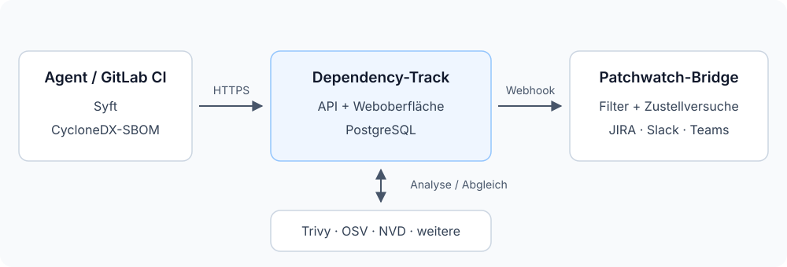

# Patchwatch

Patchwatch erfasst Software auf Entwickler-Rechnern und in GitLab-Projekten als
SBOM, gleicht den Bestand über Dependency-Track mit Schwachstellenquellen ab und
meldet Findings sowie Lizenzverstöße an die zuständigen Teams.

Unterstützt werden Linux und macOS, Verzeichnis- und Image-Scans mit Syft sowie
Metadaten ausgewählter IDE- und Browser-Erweiterungen. Die zentrale Installation
besteht aus Dependency-Track, PostgreSQL, Frontend, Bridge und Trivy-Server.
Patchwatch erkennt Schwachstellen; es installiert keine Updates auf Endgeräten.

## Architektur



Agent und CI erzeugen mit Syft das Softwareinventar. Dependency-Track speichert
und analysiert die SBOMs und zeigt Findings in der Weboberfläche. Die Bridge
übernimmt gefilterte Benachrichtigungen mit Wiederholungen bei Zustellfehlern.
Der zentrale Stack läuft mit Docker Compose oder auf Kubernetes.

## Einstieg

1. [Schnellstart mit Docker Compose](docs/getting-started.md) für die erste lokale Installation.
2. [Installation auswählen](docs/installation/index.md): Compose oder Kubernetes mit Helmfile.
3. [Agent einrichten](docs/usage/agent.md) oder [GitLab-Projekte anbinden](docs/usage/ci-integration.md).
4. [Keycloak-Login](docs/configuration/oidc.md), [Richtlinien](docs/configuration/policies.md)
   und [Benachrichtigungen](docs/configuration/alerting.md) konfigurieren.
5. [Backups, Monitoring und Updates](docs/operations/index.md) vor dem regulären Betrieb einrichten.

Die **[Dokumentationsübersicht](docs/README.md)** führt durch alle Anleitungen,
Referenzen und noch nicht implementierten Entwürfe. Alle Beispiele verwenden
neutrale Domains und Projektpfade; vor einem Deployment die
[Installationsparameter](docs/installation/customization.md) auf die eigene Umgebung abstimmen.
Die eingecheckten Kubernetes-Profile sind ein anzupassendes Referenzdeployment.

## Verwendung

- **Rechner erfassen:** Agent konfigurieren, Upload-Schlüssel hinterlegen und den regelmäßigen Scan aktivieren.
- **Projekte prüfen:** CI-Template einbinden und Repositorys oder Container-Images als SBOM hochladen.
- **Findings bearbeiten:** In der Weboberfläche Schwachstellen und Lizenzverstöße bewerten; bei Bedarf Delta- oder MR-Berichte nutzen.
- **Teams informieren:** Meldeziele und Filter konfigurieren, damit relevante Findings als Ticket oder Chat-Nachricht ankommen.

## Funktionsumfang

- Hostinventar mit stabiler Gerätezuordnung, kanonischen Tags und Registrierung.
- CycloneDX-SBOMs aus Verzeichnissen, Container-Images und GitLab-Pipelines.
- Schwachstellenanalyse mit Dependency-Track und dessen nativer Trivy-Anbindung.
- Security- und Lizenzregeln, Compliance-Berichte und optionale CI-Gates.
- Delta-Berichte und Findings-Feedback für Merge Requests.
- Persistente Benachrichtigungen über Webhooks, JIRA, Slack und Teams.
- OIDC-Anmeldung mit Keycloak-Gruppen und getrennten Aufgabenrechten.

Datenumfang, Erkennungsgrenzen und Datenschutz beschreibt die
[Architekturübersicht](docs/reference/architecture.md). Ein Enrollment-Dienst und
Agent-Installationspakete (`.deb`, `.pkg`) werden mit `packaging/build.py` gebaut ([Agent](docs/usage/agent.md)); Signierung und private Laufzeit sind noch [Entwurf](docs/design/README.md).

## Entwicklung und Prüfung

Python ≥3.12; der Anwendungscode benötigt keine zusätzlichen Python-Laufzeitpakete.
Für Deployment-Prüfungen werden Helm und Helmfile benötigt.

```sh
python3 -m unittest discover -s tests -v
python3 scripts/spdx.py --check
helm lint deploy/helm/patchwatch
python3 packaging/build.py deb      # Agent-Paket nach dist/
```

Codestruktur: `patchwatch/core` (gemeinsam), `agent` (Host-Agent, eigenständig paketierbar),
`dtrack` (Dependency-Track-Client und Administration), `ci` (GitLab-CI-Jobs) und `bridge`.
Die erlaubten Abhängigkeiten zwischen den Schichten prüft `tests/test_boundaries.py`;
Einzelheiten in der [Architekturübersicht](docs/reference/architecture.md#code-struktur).

Nach Änderungen an versionierten Quelldateien `python3 scripts/spdx.py` ausführen,
damit die [SPDX-Quellinventur](docs/reference/licenses.md) aktuell bleibt.

## Lizenz

Patchwatch steht unter **Apache-2.0**: [LICENSE](LICENSE), [NOTICE](NOTICE).
Deklarierte Abhängigkeiten und Umfang der Inventur:
[Lizenzen und SPDX](docs/reference/licenses.md).
