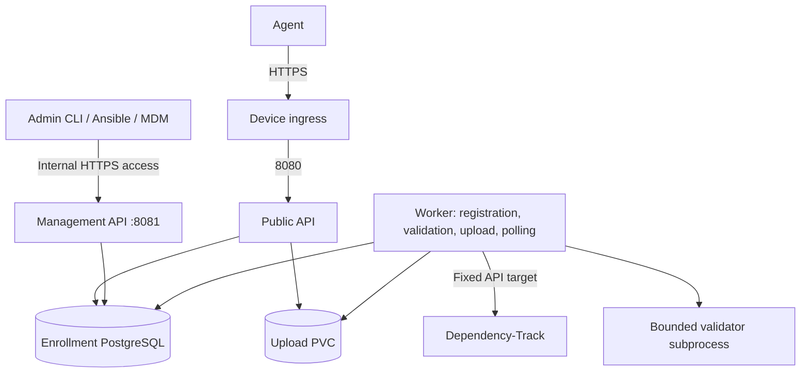
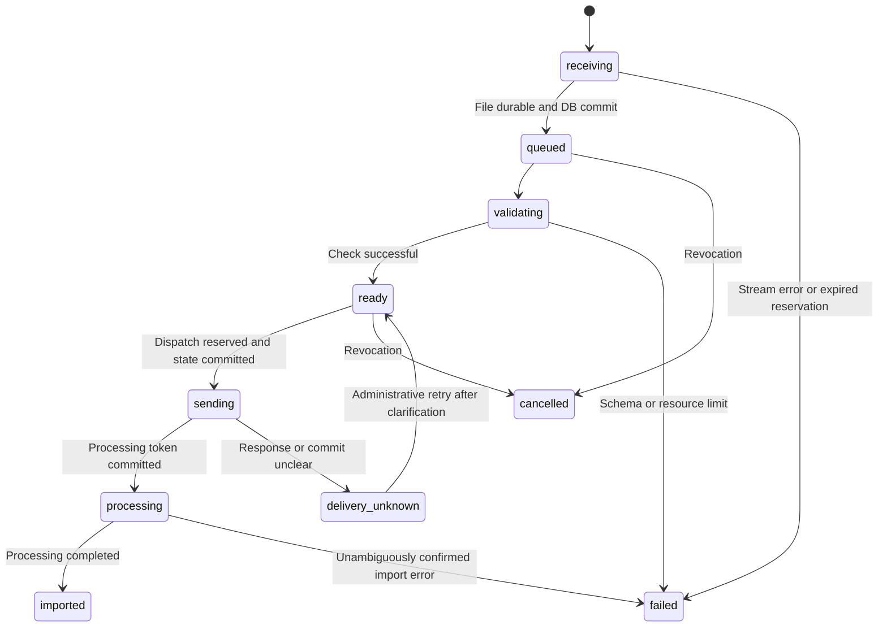

# Technical architecture of the enrollment service

As of: 14 November 2026. Executable implementation plan as a draft; the modules,
tables and endpoints described are not yet implemented. Supplements the functional
[enrollment concept](enrollment.md). For the error and state flows specified more precisely here,
this detailed design applies.

## 1. Technical decisions

| Area | Decision | Rationale |
|---|---|---|
| Server | Python ≥3.12, FastAPI/Pydantic, Uvicorn | Connection to existing code; explicit request/response models and OpenAPI |
| Storage | PostgreSQL 17, Psycopg 3 with a bounded connection pool | Transactions, constraints, persistent jobs |
| Data access | Parameterized SQL in repository modules | Locks and state changes stay visible in code; no ORM at first |
| Migration | Numbered SQL files, own migration CLI | Small, traceable schema changes; separate DDL permission |
| Backend HTTP | HTTPX with reused clients | Stream files as multipart; explicit timeouts and disabled redirects |
| SBOM validation | Streaming pre-check with `ijson`, schema/field check with `jsonschema` | Enforce limits before materialization; check CycloneDX and Patchwatch field scope |
| Job processing | PostgreSQL queue, worker outside the HTTP request | Onboarding and upload survive API crashes; no Redis/Celery in the MVP |
| Upload buffer | One private POSIX PVC, temporary and finished files | Bounded and independent of main memory; no object storage in the MVP |
| Delivery | Own server image and own Python distribution package | New server dependencies do not reach the agent or bridge |
| High availability | One pod replica with multiple roles in the pilot | Shared buffer and clear restart order; no pretended HA |

The concrete library versions are fixed together at implementation and
checked in as a lock file with hashes. They are no automatic extension of the currently
empty `dependencies` of the agent package. Server code is built as a distribution of its own in the monorepo;
shared inventory/sanitizing functions receive explicit interfaces.
The server image is built and inventoried independently of the existing bridge image.

FastAPI applications can have separate OpenAPI contracts; here, two independent
app factories are started from the same code instead of merely hiding management routes at the
ingress. Basis: [FastAPI documentation](https://fastapi.tiangolo.com/advanced/sub-applications/).
File-based multipart uploads are provided for in the [HTTPX client](https://www.python-httpx.org/quickstart/#sending-multipart-file-uploads).
The existing helpers `multipart()` and `upload_and_wait()` are not used unchanged on the server:
they build the complete body in memory and repeat
forwarding on errors without knowing a persistent send decision.

## 2. Runtime components and interfaces



One image has four start modes: `serve-public`, `serve-admin`, `worker` and `migrate`.
In the Kubernetes pilot, the first three run as separate containers of one pod with one
replica and the `Recreate` strategy. Migrations run beforehand as a separate job. In Compose
there are three services with the same image and a shared buffer volume; the migration job
must have completed successfully. A production deployment via RollingUpdate is excluded for
this MVP because old and new worker could otherwise live at the same time.

| Role | May | Does not receive |
|---|---|---|
| Public API | Authenticate devices, reserve onboarding, persist payload, read own status | DTrack keys, DDL permissions, management router |
| Management API | Invitations, profile assignment, revocation and manual resolution | Upload PVC, DTrack keys, public upload handler |
| Worker | Process jobs, check/read/delete payload, address DTrack | Management credential, public listeners |
| Migration | Change DDL and schema version | Device ingress, running scan processing |

Every role has its own DB login; a shared schema owner belongs exclusively
to the migration job. Table permissions are limited accordingly, audit is append-only for runtime roles.
This does not replace device authorization in the application code. Containers in the
same pod share the network identity; the public API here is no hard network
security boundary against the worker. Separate pods and separate service identities
are a later hardening step with suitable shared storage.

The API makes no DTrack calls within requests. The worker uses only
persisted, verified data and a fixed configured backend URL. Before productive
start, the reachability of the management API from the public ingress is tested negatively.

## 3. Code layout

Intended structure, no implementation files to be created yet:

```text
server/enrollment/
  pyproject.toml                 # own server distribution and dependencies
  src/patchwatch_enrollment/
    apps/public.py              # device and onboarding routers only
    apps/admin.py               # management routers only
    api/models.py               # small JSON requests and responses
    auth.py                     # token parser, digest check, AuthContext
    services/enrollments.py     # atomic onboarding and re-onboarding
    services/credentials.py     # rotation and confirmation
    services/uploads.py        # acceptance, idempotency and status
    services/profiles.py        # versioned profile assignment
    repositories/              # SQL per functional area
    workers/dispatch.py         # claims, leases, send locks
    workers/registration.py     # DTrack assignment and reconciliation
    workers/uploads.py         # validation, sending, polling
    validation.py              # SBOM subprocess without backend credentials
    dtrack.py                  # bounded backend client, no implicit retries
    spool.py                   # file paths, synchronization, cleanup
    maintenance.py             # TTL, expired reservations, metrics
    cli.py                     # management and migration
    migrations/                # 0001_initial.sql, ...
```

Handlers contain HTTP mapping, authentication and the call of a service. Transactions
live in the service and cover exactly the required repository calls. Repositories
perform no hidden commits of their own. Database connections use explicit,
short transactions; network access, file streaming and validation run outside them.
This avoids open transactions during long I/O phases; see
[Psycopg transaction management](https://www.psycopg.org/psycopg3/docs/basic/transactions.html).

## 4. Relational data model

All IDs are UUIDs, all times `timestamptz` in UTC. States are `text` with CHECK
constraints, version/sequence numbers `bigint`, sizes `bigint`, secret digests `bytea`
of exactly 32 bytes. API outputs format times as RFC 3339 with `Z`.

| Table | Key columns | Constraints and indexes |
|---|---|---|
| `profiles` | `id`, `version`, `schema_version`, `body jsonb`, `body_sha256`, `created_by`, `created_at` | PK `(id, version)`; published rows immutable |
| `devices` | `id`, `host_id`, `project_uuid`, `state`, `generation`, `hostname`, `reported_metadata jsonb`, `approved_metadata jsonb`, `metadata_revision`, `registered_revision`, `profile_id`, `profile_version`, `org_tags jsonb`, `next_upload_sequence`, `last_seen_at`, `last_imported_at`, `row_version` | Unique `host_id`, nullable unique `project_uuid`; FK to the exact profile; `active` requires a project UUID |
| `credentials` | `id`, `device_id`, `generation`, `slot`, `secret_digest`, `created_at`, `expires_at`, `confirmed_at`, `revoked_at`, `rotation_request_id` | FK device; partial unique `(device_id, slot)` for non-revoked rows; slot 0 or 1; rotation ID unique per device |
| `invitations` | `id`, `secret_digest`, `state`, `expires_at`, `expected_host_id`, `expected_hostname`, `target_device_id`, `target_generation`, `profile_id/version`, `org_tags`, `consumed_device_id`, `enrollment_request_id`, `request_digest`, `created_by` | FK to profile and, if applicable, existing device; redemption only once; request ID unique if set |
| `registration_jobs` | `id`, `device_id`, `generation`, `metadata_revision`, `state`, `attempts`, `next_run_at`, `lease_owner`, `lease_until`, `lease_epoch`, `last_error_code` | Unique `(device_id, generation, metadata_revision)`; index on due states |
| `upload_jobs` | `id`, `device_id`, `generation`, `scan_id`, `sequence`, `state`, `declared_sha256`, `actual_sha256`, `declared_bytes`, `actual_bytes`, `profile_id/version`, `metadata_revision`, `spool_key`, `dtrack_token`, `expires_at`, lease/error fields | Unique `(device_id, scan_id)` and `(device_id, sequence)`; partial: at most one open upload per device |
| `device_dispatch` | `device_id`, `job_kind`, `job_id`, `lease_owner`, `lease_until`, `epoch`, `barrier_reason`, `updated_at` | One row per device; serializes registration and upload sending |
| `upload_reservations` | `id`, `device_id`, `job_id`, `reserved_bytes`, `lease_until`, `owner` | FK to internal `receiving` job; also counts running HTTP streams |
| `quota_buckets` | `id`, `limit_bytes`, `used_bytes`, `limit_slots`, `used_slots` | Reservation under row lock; CHECK for non-negative counters |
| `admin_principals` | `id`, `credential_id`, `secret_digest`, `role`, `expires_at`, `revoked_at` | Separate credential namespace; initialization via local bootstrap CLI |
| `audit_events` | `id`, `occurred_at`, `actor_type`, `actor_id`, `action`, `target_type/id`, `request_id`, `details jsonb` | Index on time and target; details exclusively approved fields |
| `schema_migrations` | `version`, `checksum`, `applied_at` | PK version; checksum deviation prevents start |

`generation` separates access periods of the same asset: a re-onboarding increments it.
A credential is valid only if its generation matches the current device generation.
Jobs of older generations may no longer be newly sent. A DTrack job already running
must be reconciled before the new generation is released.

A `slot` limits simultaneously existing device credentials to two. Before rotation, expired
rows are revoked under the device lock so that they release their slot. Historical
rows are kept for audit. The assignment to the same device and to the current
generation is checked on every mutation; the slot index alone checks no validity.

Example of central constraints; not a complete migration script:

```sql
CREATE UNIQUE INDEX uq_credential_slot
    ON credentials (device_id, slot)
    WHERE revoked_at IS NULL;

CREATE UNIQUE INDEX uq_open_upload
    ON upload_jobs (device_id)
    WHERE state IN ('receiving', 'queued', 'validating', 'ready',
                    'sending', 'processing', 'delivery_unknown');

CREATE INDEX ix_registration_due
    ON registration_jobs (next_run_at, id)
    WHERE state IN ('queued', 'retry_wait');

ALTER TABLE devices ADD CONSTRAINT active_has_project
    CHECK (state <> 'active' OR project_uuid IS NOT NULL);
```

Application rules such as "no sending on revocation" additionally need transactions and
dispatch checks; a CHECK on one table replaces no cross-table invariant.
The constraint types used are described in the [PostgreSQL documentation](https://www.postgresql.org/docs/17/ddl-constraints.html).
Devices, projects and historical identities are not removed through cascading deletion in
normal operation. A final deletion is a separate flow.

## 5. Authentication and request processing

Proposed token formats:

```text
pw_enr_v1.<invitation_uuid>.<base64url_32_random_bytes>
pw_dev_v1.<credential_uuid>.<base64url_32_random_bytes>
pw_adm_v1.<principal_uuid>.<base64url_32_random_bytes>
```

The prefixes distinguish purposes but are no proof of permission. Stored is
`SHA-256(domain || public_id || secret_bytes)` with separate domains per token type. Parsers
check maximum length, UUID, canonical base64url encoding and exactly 32 secret bytes.
Invalid, unknown and expired credentials yield the same generic
authentication error to the outside; audit distinguishes internally only non-critical error classes.

Order of every device request:

1. Check host, permitted path, method, content type, header and declared size limits.
2. Load the credential via its public ID and compare the digest in constant time.
3. Check expiry, revocation, device generation and device status from PostgreSQL; no positive
   auth cache in the MVP. `provisioning` and registration errors allow only own status.
4. Create an immutable `AuthContext(device_id, credential_id, generation, request_id)`.
   It contains neither token nor a device ID taken from the body.
5. Mutations check the device status again under row lock. Resource lookups always use
   `WHERE id = :id AND device_id = :authenticated_device`.
6. Serialize the response via an explicit response model. Pydantic validation errors are output
   without input values: they could contain the credential body.

Standard fields such as `request_id` and `error_code` may be logged; auth headers, JSON
bodies, SQL parameters and raw exceptions are not logged. Debug/tracing tools
and HTTPX logs must also comply with this rule. `last_seen_at` is written at most every five
minutes so that status polling does not needlessly create table updates.

## 6. Concrete onboarding and configuration contracts

Small JSON requests are limited to 64 KiB, have `additionalProperties: false` and
use fixed schema versions. Examples contain placeholders exclusively.

`POST /v1/enrollments`, Authorization: invitation token:

```json
{
  "request_id": "1b1ff1dc-e61b-49e7-b8ac-8befb06191f0",
  "host_id": "b6006154-5335-49b7-87fe-311a2313dcf0",
  "hostname": "workstation-01",
  "metadata": {"os": "linux", "distro": "ubuntu", "architecture": "x86_64"},
  "agent_version": "0.1.0",
  "credential": {"id": "7a21ed7f-e09c-45eb-a118-ae8a67497c03", "secret": "<base64url-32-random-bytes>"}
}
```

The agent persists request ID, normalized metadata and credential beforehand so that
repetitions form the same functional request independent of bytes. The server stores
a digest over canonical, normalized values including the credential digest.
Normalization rules become part of the API contract; no general signature format.

`202 Accepted` with `Location: /v1/device`, `Retry-After: 5`, `Cache-Control: no-store`:

```json
{
  "device_id": "d7ecae71-391c-40b9-b3e6-95329d75b02d",
  "state": "provisioning",
  "generation": 1,
  "request_id": "1b1ff1dc-e61b-49e7-b8ac-8befb06191f0"
}
```

Onboarding transaction at `READ COMMITTED`:

1. Load the invitation `FOR UPDATE`. For an already consumed invitation, check request ID,
   request digest and possession of the device credential sent along. An identical
   repetition returns only the existing state and reactivates nothing.
2. For a new redemption, check deadline, revocation, profile and expected metadata. A normal
   invitation may not take over an existing asset ID. Re-onboarding needs an
   invitation with an explicit target device and expected generation.
3. Create or lock the device row; map conflicts on unique constraints to
   `409 IDENTITY_CONFLICT`. Re-onboarding fails if an unresolved send
   or registration call still blocks the old generation.
4. Persist credential digest and generation, consume the invitation, write registration job
   and audit. One commit makes all changes visible together.
5. Only then respond. On a connection error at commit, the commit outcome is unknown;
   the API reports no success. The agent uses a status query and identical repetition.

Repetitions of consumed invitations are allowed only with a matching, still valid
device credential; the original invitation deadline does not end the status query.
A lost management response when creating an invitation is different: the server cannot
show the token, stored only as a digest, again. The management revokes the
invitation concerned via its known request ID and creates a new one. Unknown
invitations are not multiplied by arbitrary repetitions.

An active device receives via `GET /v1/device/config`, for example:

```json
{
  "schema_version": 1,
  "profile_id": "linux-developer",
  "profile_version": 3,
  "metadata_revision": 2,
  "scan": {
    "roots": ["/usr", "/opt", "/var/lib/dpkg"],
    "scan_extensions": true,
    "detect_services": true,
    "scan_timeout": 7200,
    "excludes": []
  },
  "schedule": {"interval_seconds": 86400, "jitter_seconds": 7200},
  "limits": {"upload_bytes": 125829120, "local_spool_ttl_seconds": 86400}
}
```

`profile_id` here is the published technical name; the database internally uses a
UUID. `ETag` refers to the entire response derived from profile and device metadata;
with `If-None-Match`, `304` can follow. The agent replaces its last valid
state only after successful validation. Syft path, API target, CA, credential file and locally
approved scan areas are not overwritten by this response.

## 7. Upload acceptance and buffer transaction

Upload contract:

```http
POST /v1/device/uploads
Authorization: Bearer <device-credential>
Content-Type: application/vnd.cyclonedx+json
Content-Length: <exact-byte-count>
X-Scan-ID: <persisted-uuid>
X-Content-SHA256: <64-hex-characters>
X-Profile-Version: 3
X-Metadata-Revision: 2

<sanitized CycloneDX 1.6 JSON file>
```

The MVP requires Content-Length (`411` if missing), refuses Content-Encoding and
supports no freely configurable multipart input. The agent serializes the SBOM
once into a private file and repeats exactly these bytes; a new call of
`sanitize()` would create a new `serialNumber` and is not an identical repetition.

1. Authenticate, check headers, check device status and last confirmed metadata revision.
   The profile version must have been approved for the device at scan time and
   still be accepted within a configured transition window; the job fixes
   this version immutably. A security-relevant profile revocation can block it immediately.
2. In a short transaction, lock first the global quota bucket, then the device.
   For a known `(device_id, scan_id)`, compare declared hash, length and version fields:
   different yields `409`, identical returns the existing status, without replacing the payload.
   A body not read during this repetition is not processed as new content.
3. For a new ID, assign the sequence, create the internal job `receiving` and a byte/slot reservation.
   At most one open job per device. No DB transaction during the stream.
4. Stream the body into the server-side file `incoming/<job_uuid>.<attempt_uuid>.part`, determining
   SHA-256 and actual size at the same time. Exceeding, wrong length or wrong hash lead
   to abort, a visible error and subsequent release of the reservation.
5. `fsync` the file, rename it on the same volume to `payloads/<job_uuid>.json`, synchronize target
   and source directory. The storage driver must actually guarantee these POSIX properties.
   Paths use exclusively server-side UUIDs.
6. In a new transaction, check device status and generation again, store size and hash,
   switch the job to `queued`, convert reserved to actually occupied bytes.
   After a successful commit, `202` with upload ID and status URL is allowed.

**Clarification of the base concept:** `202 queued` confirms durable acceptance, not yet
schema or content approval. The complete validation takes place in the worker before every
DTrack access. Wrong formats can therefore end as job `failed/SBOM_INVALID`.
Authentication, header, size and hash errors before acceptance, in contrast, return 4xx directly.

The lock order for paths with a quota change is always `quota_buckets → devices →
job/reservation`. Other transactions lock `devices → job`. There is no path that
first locks a device and then a quota bucket. Audit is written within the functional
transaction. Temporary slots give atomic limits even with parallel requests.

A reconciler checks expired `receiving` leases: after the end of the responsible stream,
remove files, cancel the job and release the quota. On a lost DB connection,
the stream stops before its lease expires. After file renaming but before commit, a
file is not yet an accepted job; it may be cleaned up after reconciliation. Missing
files for `queued`/`ready` lead to `PAYLOAD_MISSING`, never to an empty upload.

## 8. Validation and storage limits

A validator subprocess handles one file at a time. The worker passes an
already opened, read-only file descriptor and a minimal configuration; no
key values, DB connections or backend sockets are passed. The subprocess
has a sanitized environment; error output is limited to fixed codes. Under the same
UID it can in principle still access mounted worker secrets. This is
resource isolation, no secret or network sandbox. A hard separation needs
a validator container or pod of its own without secret mounts and backend access.

Two check phases:

1. Streaming check for valid UTF-8/JSON, maximum depth, string length, number of elements,
   duplicate object keys, no NaN/Infinity values and the expected format header.
2. Complete check against locally bundled CycloneDX 1.6 schemas and a stricter
   Patchwatch allowlist. No dynamic loading of `$ref` URLs. Permitted are the component, license, path, service and
   dependency fields actually produced by the agent.
   Recorded asset ID and host root must match the job snapshot. Unknown fields,
   foreign references and empty inventories without profile approval are rejected.

Initial protection limits, to be verified with real devices before production release:

| Limit | Proposed starting value |
|---|---|
| Pure SBOM | 120 MiB |
| JSON depth | 32 |
| Single string | 16 KiB, functional fields possibly considerably smaller |
| Components / dependency edges | 100,000 / 500,000 |
| Services | 10,000 |
| Total JSON parser events | 5 million |
| Validator | 1 concurrent, 120 seconds runtime, 2 GiB address space limit |

The validator is terminated on CPU/memory overrun; the API stays available in another
container. A 120 MiB JSON can become considerably larger as a Python object. Process limits
and streaming pre-check are therefore necessary; "120 MiB upload" is no commitment
about memory needs. These limits can reject a formally valid but overly complex
document. Load tests decide on release or adaptation of the format/limit.

## 9. States, worker claims and safe forwarding

Device states: `provisioning → active`, `registration_conflict` on identity conflicts,
`revoked` on revocation. `active` requires a confirmed project. Contact age and import age
are derived operating states, no substitute authentication. Metadata changes increase
`metadata_revision`; until this revision is registered, new uploads are deferred with
`REGISTRATION_PENDING`. Uploads already accepted are completed in order beforehand.
A device cannot free itself from a send lock by renaming.



Internal states `receiving`, `validating` and `ready` appear publicly as
`receiving`, `validating` and `queued` respectively, additionally with a released phase.
Accepting a new scan ID again stays blocked until the terminal state.
Failed jobs with a still-open external effect do not count as terminal here.

Claims use short transactions: load a due candidate with `FOR UPDATE SKIP LOCKED`,
commit; then check suitability again under the device lock and set a lease. The
first candidate lookup is only a hint, no right to send. Leases initially run
90 seconds and are renewed every 20 seconds. Every claim increases `lease_epoch`;
result updates need matching job ID, owner and epoch.

`SKIP LOCKED` suits competing queue consumers; it replaces no ordering
or functional device lock. Basis: [PostgreSQL SELECT](https://www.postgresql.org/docs/17/sql-select.html).
Network I/O holds neither row lock nor an open DB transaction. DB-internal epochs prevent
outdated updates but cannot stop an HTTP call to DTrack that has already started.

`device_dispatch` therefore contains a persistent send right with the following rule:

- Registration and BOM forwarding share the same device lock.
- Before the HTTP call, the worker stores `sending`, generation, target and dispatch epoch
  in one transaction and checks lock status and payload again.
- On a crash or lease loss in `sending`, the dispatch row remains as a barrier.
  The next worker sets `delivery_unknown` and does not send again.
- A late old worker may report a received token as immutable send
  evidence for the same job but may not take over a newer dispatch epoch.
- The resolver takes over a documented token for status checking or requests manual
  clarification. The mere passing of a period does not lift the barrier.

A renewed send after an unclear outcome requires the old sender to be excluded and
DTrack processing clarified. If that cannot be demonstrated, the device stays blocked.
An administrative continuation under remaining uncertainty is possible only as an explicitly
audited risk override; the ordering guarantee is then suspended. The normal
CLI path does not offer this override. A retry with a retained barrier is no substitute
for fencing by the target system.

The same rule applies to project creation: a project found unambiguously after an unclear request,
with matching name, version and asset ID, can be adopted. A project not
found at the moment does not yet prove that an old request will not create it later.
Without such clarification, no second creation attempt is started. Unambiguous negative responses
and connections that failed demonstrably before sending, in contrast, can be retried in a limited way.

## 10. DTrack adapter and error classification

The adapter offers only `lookup_registration_target()`, `create_project()`,
`update_project()`, `submit_bom()` and `get_bom_status()`. It returns typed results,
no raw HTTP objects to the device API. Upload and registration clients have
separate keys. Permissions are verified against the running DTrack version.

| Situation | Behavior |
|---|---|
| Read-only lookup or token polling temporarily unreachable | Backoff with jitter, no new forwarding |
| DNS/connect error demonstrably before sending | Limited retry, e.g. 5 s, 15 s, 45 s, then alarm |
| BOM unambiguously rejected by DTrack | `failed`, non-critical error code; claim no data change |
| 401/403 from the backend | Global operational alarm, no change to device credentials |
| Timeout/abort after possible sending or unclear 5xx response | Barrier and `delivery_unknown` |
| Token known, `processing=true` | Keep polling after five seconds; do not hold the lease during the wait |
| Token known, completion still unclear after 30 minutes | Alarm and persisting `processing`; no next SBOM |
| Project vanished after registration | `PROJECT_MISSING`, reassign administratively; no AutoCreate |

HTTP starting values: connect 5 s, write inactivity 60 s, read inactivity 30 s,
total budget for BOM forwarding 300 s, small backend responses at most 1 MiB. Timeout types
are handled separately. Multipart streams the existing file and contains only the server-side
project and BOM. Backend redirects are off; unconfigured proxy targets are off.
No general retry middleware may automatically repeat POST/PUT calls.

The existing agent interprets `processing=false` as the end of the import. Whether this
status of the DTrack version in use also distinguishes every import error unambiguously
is an integration test and release criterion. Without this proof, the public
state is called only `processing_completed`, with `import_outcome=unknown`, and not
`imported`. A token that is merely no longer processing must give no false success signal.

## 11. Rotation, revocation and agent state

Rotation has three steps: persist a new credential locally, register it idempotently
with the old credential, confirm it with the new credential via
`POST /v1/device/credentials/{id}/confirm`. Until confirmation, the new
rotation credential may call only own status and confirmation, no uploads yet.
Confirmation limits the validity of the old credential to at most 24 hours after
registration of the new one. The original expiry date of the old one is never extended.
Unconfirmed rotations are ended after 24 hours: the new credential is revoked,
the old one keeps its original expiry date. This way, a lost rotation
does not permanently consume the second slot. The first credential of a normal onboarding is no
unconfirmed rotation credential; its access follows the device status.

Confirmation needs the new credential itself; an old credential cannot confirm its
possession. If the confirmation response is lost, the new credential can still check
the status and repeat the identical confirm request. After successful confirmation
and local switch-over, the agent explicitly revokes the old credential. A credential already
revoked or expired never becomes active again through repetition.

Kept separately locally:

```text
/etc/patchwatch/bootstrap.json        # fixed API target, CA and permitted local scan areas
/etc/patchwatch/device-credentials    # current and, if applicable, new credential, 0600
/var/lib/patchwatch/enrollment.json   # request ID and re-onboarding state, 0600
/var/lib/patchwatch/config.json       # last valid profile and revision, 0600
/var/lib/patchwatch/uploads/          # at most one sanitized, repeatable upload
/var/lib/patchwatch/status.json       # last scan, upload ID and confirmed import
```

Credential file and rotation state are kept together in one atomically replaced file.
Directories are private; on macOS, corresponding owner/mode permissions apply.
Existing scan locks also protect onboarding, rotation and local state change against
parallel agent processes. A revoked device starts no further uploads. Data already
collected locally expires after its period. The agent does not fall back to direct DTrack upload.

A state revoked by the management is committed under the device lock with generation and
credential revocation. A subsequent worker send is prohibited. Backend calls
already authorized or started before this commit can still arrive;
the response to the revocation command therefore shows open in-flight jobs explicitly.
A reliable immediate recall of data already sent is not part of the revocation semantics.

## 12. Deployment, capacity and operation

Proposed pilot configuration, no measured performance commitment:

| Role/resource | Starting value |
|---|---|
| Public API | 1 process, 256 MiB request / 512 MiB limit, DB pool at most 5 |
| Management API | 1 process, 128 MiB request / 256 MiB limit, pool at most 3 |
| Worker incl. validator | 512 MiB request / 3 GiB limit, pool at most 5, one validator |
| DTrack forwarding | At most two different devices in parallel, one open operation per device |
| Incoming streams | At most four globally, one per device |
| Buffer | PVC 20 GiB, logical budget 10 GiB, at least 2 GiB physical free space |
| Database | Own DB/user in the existing PostgreSQL, measure additional budget |
| API polling | Agent respects `Retry-After`, jitter, at most one status poll per five seconds |

A 10 GiB payload budget suffices arithmetically for about 85 uploads of 120 MiB each; running
reservations count as well. A DTrack outage with hundreds of simultaneously active devices
can therefore fill the buffer. `503 Retry-After` plus a private agent buffer is deliberately part
of the design; unbounded collection of all daily inventories is no MVP requirement.

Ingress rules: only the device host public, management host exclusively internal, no
public `/docs`, `/openapi.json`, `/metrics` or health details. For uploads, request buffering
at the proxy is disabled or its memory/buffer budgeted separately;
otherwise the API quotas would not limit the upstream storage. Default body limit
for small JSON routes 64 KiB, own upload route 120 MiB. Idle limit 30 s, total limit 300 s.
Forwarded proxy headers are accepted only from configured ingress addresses.

Liveness checks only local process progress. Readiness checks schema compatibility,
database and, for the public API, buffer access. A DTrack outage does not make the API immediately
unready; onboarding is possible until quota exhaustion. The worker reports heartbeat, oldest
jobs and barriers. Metrics contain no device IDs as labels; details belong in
the access-protected status view.

Rollout: briefly drain onboardings, end streams, let the worker start no new sends,
complete running sends or leave them as unclear, then replace the pod. Migrations
run with an exclusive migration lock and checksum check. Schema changes follow
expand/migrate/contract; a binary rollback is permitted only within the documented compatible schema window.
Automatic destructive down migrations are not provided.

TTL cleanup removes even unresolved payloads after 24 hours, **but never their external
send barrier**. The job stays `delivery_unknown` or `processing` with the addition
`payload_expired`; the device is not released for sending again as a result. Status data
is deleted only after clarification of terminal jobs per the period. Deviations from the
base concept thus avoid accidental release through storage cleanup alone.

Restore starts in administrative maintenance mode with the device ingress externally blocked.
Invitations and credentials are invalidated according to the base concept; the
worker stays stopped until possible external sends are reconciled. A generic
readiness probe does not lift this maintenance mode. Missing buffer files are visibly
marked. The renewed onboarding takes over the existing project assignments after checking.

## 13. Verification and remaining integration decisions

| Test level | Key evidence |
|---|---|
| Domain/authorization tests | Generation, invitation conflict, rotation, foreign IDs, safe error responses |
| PostgreSQL integration with two connections | Parallel redemption, quotas, unique indexes, lock order, lease epochs |
| Process/file system tests | Crash after fsync, rename and commit; stream abort; TTL without loss of barriers |
| Controlled HTTP backend dummy | Response loss after acceptance, late sender, token loss, 429/5xx without blind retry |
| Real DTrack 5.2.1 instance | Minimal permissions, project reconciliation, import errors, status semantics, tag/UUID preservation |
| End to end Linux/macOS | Onboarding, scan, upload, profile change, rotation, migration, revocation |
| Load and recovery test | Large/complex SBOM, full buffer, DTrack outage, rollout during sending, restore |

Before implementation, only the lock file and the exact DTrack endpoint permissions are
determined. Before productive release, validator limits, PVC synchronization
properties, import status semantics and resource budgets must additionally be demonstrated. These points
are measurable release criteria; the remaining architecture can be implemented independently of them.
