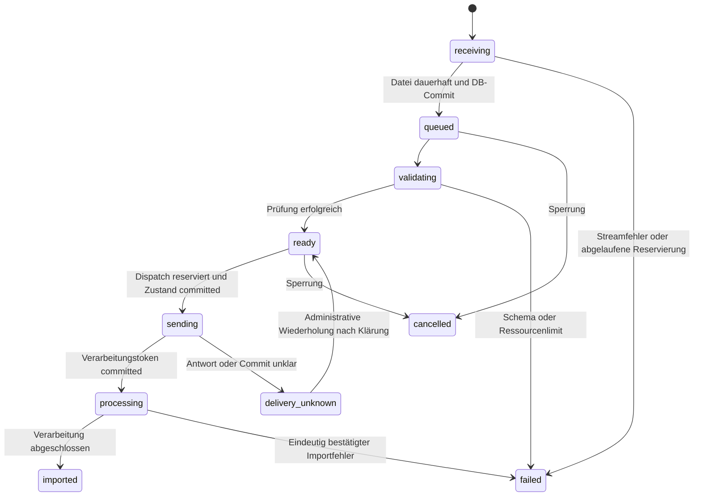

# Technische Architektur des Enrollment-Dienstes

Stand: 14. November 2026. Ausführbarer Implementierungsplan als Entwurf; die beschriebenen
Module, Tabellen und Endpunkte sind noch nicht implementiert. Ergänzt das fachliche
[Enrollment-Konzept](enrollment.md). Bei den hier präzisierten Fehler- und Zustandsabläufen
gilt dieser Detailentwurf.

## 1. Technische Entscheidungen

| Bereich | Entscheidung | Begründung |
|---|---|---|
| Server | Python ≥3.12, FastAPI/Pydantic, Uvicorn | Anschluss an bestehenden Code; explizite Request-/Response-Modelle und OpenAPI |
| Speicherung | PostgreSQL 17, Psycopg 3 mit begrenztem Connection-Pool | Transaktionen, Constraints, persistente Aufträge |
| Datenzugriff | Parametrisiertes SQL in Repository-Modulen | Sperren und Zustandswechsel bleiben im Code sichtbar; zunächst kein ORM |
| Migration | Nummerierte SQL-Dateien, eigene Migration-CLI | Kleine, nachvollziehbare Schemaänderungen; separates DDL-Recht |
| Backend-HTTP | HTTPX mit wiederverwendeten Clients | Dateien als Multipart streamen; explizite Timeouts und deaktivierte Redirects |
| SBOM-Prüfung | Streaming-Vorprüfung mit `ijson`, Schema-/Feldprüfung mit `jsonschema` | Grenzen vor Materialisierung erzwingen; CycloneDX und Patchwatch-Feldumfang prüfen |
| Auftragsverarbeitung | PostgreSQL-Queue, Worker außerhalb des HTTP-Requests | Aufnahme und Upload überleben API-Abstürze; kein Redis/Celery im MVP |
| Upload-Puffer | Ein privates POSIX-PVC, temporäre und fertige Dateien | Begrenzt und unabhängig vom Arbeitsspeicher; kein Objektspeicher im MVP |
| Auslieferung | Eigenes Server-Image und eigenes Python-Distributionspaket | Neue Serverabhängigkeiten gelangen nicht in Agent oder Bridge |
| Hochverfügbarkeit | Eine Pod-Replik mit mehreren Rollen im Pilot | Gemeinsamer Puffer und klare Restart-Reihenfolge; keine vorgetäuschte HA |

Die konkreten Bibliotheksversionen werden bei Implementierung gemeinsam festgesetzt und
als Lockdatei mit Hashes eingecheckt. Sie sind keine automatische Erweiterung der aktuell
leeren `dependencies` des Agent-Pakets. Servercode wird als eigene Distribution im Monorepo
gebaut; gemeinsam genutzte Inventar-/Bereinigungsfunktionen erhalten explizite Schnittstellen.
Das Server-Image wird unabhängig vom bisherigen Bridge-Image gebaut und inventarisiert.

FastAPI-Anwendungen können getrennte OpenAPI-Verträge besitzen; hier werden aus demselben
Code zwei eigenständige App-Factories gestartet, statt Managementrouten nur am Ingress zu
verstecken. Grundlage: [FastAPI-Dokumentation](https://fastapi.tiangolo.com/advanced/sub-applications/).
Dateibasierte Multipart-Uploads sind im [HTTPX-Client](https://www.python-httpx.org/quickstart/#sending-multipart-file-uploads)
vorgesehen. Die bestehenden Helfer `multipart()` und `upload_and_wait()` werden serverseitig
nicht unverändert genutzt: Sie bauen den vollständigen Body im Speicher und wiederholen
die Weiterleitung bei Fehlern, ohne eine persistente Versandentscheidung zu kennen.

## 2. Laufzeitkomponenten und Schnittstellen


Ein Image hat vier Startmodi: `serve-public`, `serve-admin`, `worker` und `migrate`.
Im Kubernetes-Pilot laufen die ersten drei als getrennte Container eines Pods mit einer
Replik und `Recreate`-Strategie. Migrationen laufen vorher als separater Job. In Compose
sind es drei Services mit demselben Image und gemeinsamen Puffervolume; der Migrationsjob
muss erfolgreich abgeschlossen sein. Ein Produktions-Deployment per RollingUpdate ist für
diesen MVP ausgeschlossen, weil alter und neuer Worker sonst gleichzeitig leben können.

| Rolle | Darf | Erhält nicht |
|---|---|---|
| Public API | Geräte authentisieren, Aufnahme reservieren, Payload persistieren, eigenen Status lesen | DTrack-Schlüssel, DDL-Rechte, Management-Router |
| Management API | Einladungen, Profilzuordnung, Sperrung und manuelle Auflösung | Upload-PVC, DTrack-Schlüssel, Public-Uploadhandler |
| Worker | Aufträge bearbeiten, Payload prüfen/lesen/löschen, DTrack adressieren | Verwaltungs-Credential, öffentliche Listener |
| Migration | DDL und Schema-Version ändern | Geräte-Ingress, laufende Scanverarbeitung |

Jede Rolle hat einen eigenen DB-Login; ein gemeinsamer Schema-Owner gehört ausschließlich
dem Migrationsjob. Tabellenrechte werden entsprechend begrenzt, Audit ist für Laufzeitrollen
nur anfügbar. Das ersetzt nicht die Geräteautorisierung im Anwendungscode. Container im
gleichen Pod teilen die Netzwerkidentität; die Public API ist hier keine harte Netzwerk-
Sicherheitsgrenze gegenüber dem Worker. Separate Pods und getrennte Service-Identitäten
sind ein späterer Härtungsschritt mit passendem gemeinsamem Speicher.

Die API macht keine DTrack-Aufrufe innerhalb von Requests. Der Worker verwendet nur
persistierte, geprüfte Daten und eine fest konfigurierte Backend-URL. Vor dem produktiven
Start wird die Erreichbarkeit der Management-API vom öffentlichen Ingress negativ getestet.

## 3. Code-Aufteilung

Vorgesehene Struktur, noch keine anzulegenden Implementierungsdateien:

```text
server/enrollment/
  pyproject.toml                 # eigene Serverdistribution und Abhängigkeiten
  src/patchwatch_enrollment/
    apps/public.py              # nur Geräte- und Aufnahme-Router
    apps/admin.py               # nur Management-Router
    api/models.py               # kleine JSON-Requests und Responses
    auth.py                     # Tokenparser, Digestprüfung, AuthContext
    services/enrollments.py     # atomare Aufnahme und Wiederaufnahme
    services/credentials.py     # Rotation und Bestätigung
    services/uploads.py        # Annahme, Idempotenz und Status
    services/profiles.py        # versionierte Profilzuordnung
    repositories/              # SQL je fachlichem Bereich
    workers/dispatch.py         # Claims, Leases, Versandsperren
    workers/registration.py     # DTrack-Zuordnung und Reconciliation
    workers/uploads.py         # Validierung, Versand, Polling
    validation.py              # SBOM-Unterprozess ohne Backend-Zugangsdaten
    dtrack.py                  # begrenzter Backend-Client, keine impliziten Retries
    spool.py                   # Dateipfade, Synchronisation, Bereinigung
    maintenance.py             # TTL, abgelaufene Reservierungen, Metriken
    cli.py                     # Management und Migration
    migrations/                # 0001_initial.sql, ...
```

Handler enthalten HTTP-Abbildung, Authentisierung und Aufruf eines Services. Transaktionen
liegen im Service und umfassen genau die benötigten Repository-Aufrufe. Repositories
führen keine eigenen versteckten Commits aus. Die Datenbankverbindungen nutzen explizite,
kurze Transaktionen; Netzwerkzugriffe, Dateistreaming und Validierung laufen außerhalb davon.
Das vermeidet offene Transaktionen während langer I/O-Phasen; siehe
[Psycopg-Transaktionsverwaltung](https://www.psycopg.org/psycopg3/docs/basic/transactions.html).

## 4. Relationales Datenmodell

Alle IDs sind UUIDs, alle Zeiten `timestamptz` in UTC. Zustände sind `text` mit CHECK-
Constraints, Versions-/Sequenznummern `bigint`, Größen `bigint`, Geheimnisdigests `bytea`
mit genau 32 Bytes. API-Ausgaben formatieren Zeiten als RFC-3339 mit `Z`.

| Tabelle | Wesentliche Spalten | Constraints und Indizes |
|---|---|---|
| `profiles` | `id`, `version`, `schema_version`, `body jsonb`, `body_sha256`, `created_by`, `created_at` | PK `(id, version)`; veröffentlichte Zeilen unveränderlich |
| `devices` | `id`, `host_id`, `project_uuid`, `state`, `generation`, `hostname`, `reported_metadata jsonb`, `approved_metadata jsonb`, `metadata_revision`, `registered_revision`, `profile_id`, `profile_version`, `org_tags jsonb`, `next_upload_sequence`, `last_seen_at`, `last_imported_at`, `row_version` | Unique `host_id`, nullable Unique `project_uuid`; FK zum exakten Profil; `active` benötigt Projekt-UUID |
| `credentials` | `id`, `device_id`, `generation`, `slot`, `secret_digest`, `created_at`, `expires_at`, `confirmed_at`, `revoked_at`, `rotation_request_id` | FK Gerät; partiell Unique `(device_id, slot)` für nicht widerrufene Zeilen; Slot 0 oder 1; Rotation-ID je Gerät eindeutig |
| `invitations` | `id`, `secret_digest`, `state`, `expires_at`, `expected_host_id`, `expected_hostname`, `target_device_id`, `target_generation`, `profile_id/version`, `org_tags`, `consumed_device_id`, `enrollment_request_id`, `request_digest`, `created_by` | FK auf Profil und ggf. bestehendes Gerät; Einlösung nur einmal; Request-ID eindeutig, wenn gesetzt |
| `registration_jobs` | `id`, `device_id`, `generation`, `metadata_revision`, `state`, `attempts`, `next_run_at`, `lease_owner`, `lease_until`, `lease_epoch`, `last_error_code` | Unique `(device_id, generation, metadata_revision)`; Index auf fällige Zustände |
| `upload_jobs` | `id`, `device_id`, `generation`, `scan_id`, `sequence`, `state`, `declared_sha256`, `actual_sha256`, `declared_bytes`, `actual_bytes`, `profile_id/version`, `metadata_revision`, `spool_key`, `dtrack_token`, `expires_at`, Lease-/Fehlerfelder | Unique `(device_id, scan_id)` und `(device_id, sequence)`; partiell maximal ein offener Upload je Gerät |
| `device_dispatch` | `device_id`, `job_kind`, `job_id`, `lease_owner`, `lease_until`, `epoch`, `barrier_reason`, `updated_at` | Eine Zeile je Gerät; serialisiert Registrierung und Uploadversand |
| `upload_reservations` | `id`, `device_id`, `job_id`, `reserved_bytes`, `lease_until`, `owner` | FK auf internen `receiving`-Auftrag; zählt laufende HTTP-Streams mit |
| `quota_buckets` | `id`, `limit_bytes`, `used_bytes`, `limit_slots`, `used_slots` | Reservierung unter Zeilensperre; CHECK auf nichtnegative Zähler |
| `admin_principals` | `id`, `credential_id`, `secret_digest`, `role`, `expires_at`, `revoked_at` | Getrennter Credential-Namensraum; Initialisierung über lokale Bootstrap-CLI |
| `audit_events` | `id`, `occurred_at`, `actor_type`, `actor_id`, `action`, `target_type/id`, `request_id`, `details jsonb` | Index auf Zeit und Ziel; Details ausschließlich freigegebene Felder |
| `schema_migrations` | `version`, `checksum`, `applied_at` | PK Version; Checksum-Abweichung verhindert Start |

`generation` trennt Zugangsperioden desselben Assets: Eine Wiederaufnahme inkrementiert sie.
Ein Credential ist nur gültig, wenn seine Generation der aktuellen Gerätegeneration entspricht.
Aufträge aus älteren Generationen dürfen nicht mehr neu versendet werden. Ein schon laufender
DTrack-Auftrag muss vor Freigabe der neuen Generation abgeglichen werden.

Ein `slot` begrenzt gleichzeitig vorhandene Geräte-Credentials auf zwei. Vor Rotation werden
abgelaufene Zeilen unter Gerätesperre widerrufen, damit sie ihren Slot freigeben. Historische
Zeilen bleiben für Audit erhalten. Die Zuordnung zum gleichen Gerät und zur aktuellen
Generation wird bei jeder Mutation geprüft; der Slotindex allein prüft keine Gültigkeit.

Beispiel für zentrale Constraints; kein vollständiges Migrationsskript:

```sql
CREATE UNIQUE INDEX uq_credential_slot
    ON credentials (device_id, slot)
    WHERE revoked_at IS NULL;

CREATE UNIQUE INDEX uq_open_upload
    ON upload_jobs (device_id)
    WHERE state IN ('receiving', 'queued', 'validating', 'ready',
                    'sending', 'processing', 'delivery_unknown');

CREATE INDEX ix_registration_due
    ON registration_jobs (next_run_at, id)
    WHERE state IN ('queued', 'retry_wait');

ALTER TABLE devices ADD CONSTRAINT active_has_project
    CHECK (state <> 'active' OR project_uuid IS NOT NULL);
```

Anwendungsregeln wie „kein Versand bei Sperre“ benötigen zusätzlich Transaktionen und
Dispatch-Prüfung; ein CHECK auf einer Tabelle ersetzt keine tabellenübergreifende Invariante.
Die verwendeten Constraint-Arten sind in der [PostgreSQL-Dokumentation](https://www.postgresql.org/docs/17/ddl-constraints.html)
beschrieben. Geräte, Projekte und historische Identitäten werden im normalen Betrieb nicht
per kaskadierender Löschung entfernt. Eine endgültige Löschung ist ein separater Ablauf.

## 5. Authentisierung und Request-Verarbeitung

Vorgeschlagene Tokenformate:

```text
pw_enr_v1.<invitation_uuid>.<base64url_32_random_bytes>
pw_dev_v1.<credential_uuid>.<base64url_32_random_bytes>
pw_adm_v1.<principal_uuid>.<base64url_32_random_bytes>
```

Die Präfixe unterscheiden Zwecke, sind aber kein Berechtigungsnachweis. Gespeichert wird
`SHA-256(domain || public_id || secret_bytes)` mit getrennten Domains je Tokentyp. Parser
prüfen maximale Länge, UUID, kanonische Base64url-Kodierung und exakt 32 Geheimnisbytes.
Ungültige, unbekannte und abgelaufene Zugangsdaten liefern nach außen denselben generischen
Authentisierungsfehler; Audit unterscheidet intern nur unkritische Fehlerklassen.

Reihenfolge jedes Geräte-Requests:

1. Host, erlaubten Pfad, Methode, Content-Type, Header- und deklarierte Größenlimits prüfen.
2. Credential über öffentliche ID laden und Digest zeitkonstant vergleichen.
3. Ablauf, Widerruf, Gerätegeneration und Gerätestatus aus PostgreSQL prüfen; kein positiver
   Auth-Cache im MVP. `provisioning` und Registrierungsfehler erlauben nur eigenen Status.
4. Einen unveränderlichen `AuthContext(device_id, credential_id, generation, request_id)`
   erzeugen. Er enthält weder Token noch vom Body übernommene Geräte-ID.
5. Mutationen prüfen den Gerätestatus unter Zeilensperre erneut. Ressourcen-Lookups verwenden
   immer `WHERE id = :id AND device_id = :authenticated_device`.
6. Antwort über explizites Response-Modell serialisieren. Pydantic-Validierungsfehler werden
   ohne Eingabewerte ausgegeben: Sie könnten den Credential-Body enthalten.

Standardfelder wie `request_id` und `error_code` dürfen geloggt werden; Auth-Header, JSON-
Bodies, SQL-Parameter und rohe Exceptions werden nicht geloggt. Auch Debug-/Tracing-Tools
und HTTPX-Logs müssen diese Vorgabe einhalten. `last_seen_at` wird höchstens alle fünf
Minuten geschrieben, damit Statuspolling nicht unnötig Tabellenupdates erzeugt.

## 6. Konkrete Aufnahme- und Konfigurationsverträge

Kleine JSON-Requests sind auf 64 KiB begrenzt, besitzen `additionalProperties: false` und
verwenden feste Schema-Versionen. Beispiele enthalten ausschließlich Platzhalter.

`POST /v1/enrollments`, Authorization: Einladungstoken:

```json
{
  "request_id": "1b1ff1dc-e61b-49e7-b8ac-8befb06191f0",
  "host_id": "b6006154-5335-49b7-87fe-311a2313dcf0",
  "hostname": "workstation-01",
  "metadata": {"os": "linux", "distro": "ubuntu", "architecture": "x86_64"},
  "agent_version": "0.1.0",
  "credential": {"id": "7a21ed7f-e09c-45eb-a118-ae8a67497c03", "secret": "<base64url-32-zufallsbytes>"}
}
```

Der Agent persistiert vorher Request-ID, normalisierte Metadaten und Credential, damit
Wiederholungen byteunabhängig denselben fachlichen Request bilden. Der Server speichert
einen Digest über kanonische, normalisierte Werte einschließlich Credential-Digest.
Normalisierungsvorschriften werden Teil des API-Vertrags; kein allgemeines Signaturformat.

`202 Accepted` mit `Location: /v1/device`, `Retry-After: 5`, `Cache-Control: no-store`:

```json
{
  "device_id": "d7ecae71-391c-40b9-b3e6-95329d75b02d",
  "state": "provisioning",
  "generation": 1,
  "request_id": "1b1ff1dc-e61b-49e7-b8ac-8befb06191f0"
}
```

Aufnahmetransaktion bei `READ COMMITTED`:

1. Einladung `FOR UPDATE` laden. Bei bereits verbrauchter Einladung Request-ID,
   Request-Digest und Besitz der mitgesendeten Geräteberechtigung prüfen. Identische
   Wiederholung liefert nur bestehenden Zustand und reaktiviert nichts.
2. Bei neuer Einlösung Frist, Widerruf, Profil und erwartete Metadaten prüfen. Eine normale
   Einladung darf keine existierende Asset-ID übernehmen. Wiederaufnahme benötigt eine
   Einladung mit explizitem Zielgerät und erwarteter Generation.
3. Gerätezeile erstellen beziehungsweise sperren; Konflikte auf Unique-Constraints als
   `409 IDENTITY_CONFLICT` abbilden. Wiederaufnahme scheitert, wenn ein ungeklärter Versand
   oder Registrierungsaufruf die alte Generation noch blockiert.
4. Credential-Digest und Generation persistieren, Einladung konsumieren, Registrierungsjob
   sowie Audit schreiben. Ein Commit macht alle Änderungen gemeinsam sichtbar.
5. Erst danach antworten. Bei Commit-Verbindungsfehler ist der Commit-Ausgang unbekannt;
   die API meldet keinen Erfolg. Der Agent verwendet Statusabfrage und identische Wiederholung.

Wiederholungen verbrauchter Einladungen sind nur mit übereinstimmender, noch gültiger
Geräteberechtigung erlaubt; die ursprüngliche Einladungsfrist beendet nicht den Statusabruf.
Ein verlorenes Verwaltungs-Response bei Einladungserstellung ist anders: Der Server kann
das nur als Digest gespeicherte Token nicht erneut anzeigen. Die Verwaltung widerruft die
betroffene Einladung über ihre bekannte Request-ID und erstellt eine neue. Unbekannte
Einladungen werden nicht durch beliebige Wiederholungen vervielfacht.

Ein aktives Gerät erhält über `GET /v1/device/config` beispielsweise:

```json
{
  "schema_version": 1,
  "profile_id": "linux-developer",
  "profile_version": 3,
  "metadata_revision": 2,
  "scan": {
    "roots": ["/usr", "/opt", "/var/lib/dpkg"],
    "scan_extensions": true,
    "detect_services": true,
    "scan_timeout": 7200,
    "excludes": []
  },
  "schedule": {"interval_seconds": 86400, "jitter_seconds": 7200},
  "limits": {"upload_bytes": 125829120, "local_spool_ttl_seconds": 86400}
}
```

`profile_id` ist hier der veröffentlichte technische Name; die Datenbank nutzt intern eine
UUID. `ETag` bezieht sich auf den gesamten aus Profil und Geräte-Metadaten abgeleiteten
Response; bei `If-None-Match` kann `304` folgen. Der Agent ersetzt seinen letzten gültigen
Stand erst nach erfolgreicher Prüfung. Syft-Pfad, API-Ziel, CA, Credential-Datei und lokal
freigegebene Scanbereiche werden nicht durch diesen Response überschrieben.

## 7. Upload-Annahme und Puffertransaktion

Uploadvertrag:

```http
POST /v1/device/uploads
Authorization: Bearer <device-credential>
Content-Type: application/vnd.cyclonedx+json
Content-Length: <exakte-byteanzahl>
X-Scan-ID: <persistierte-uuid>
X-Content-SHA256: <64-hexzeichen>
X-Profile-Version: 3
X-Metadata-Revision: 2

<bereinigte CycloneDX-1.6-JSON-Datei>
```

Der MVP verlangt Content-Length (`411`, falls fehlend), verweigert Content-Encoding und
unterstützt keinen frei konfigurierbaren Multipart-Eingang. Der Agent serialisiert die SBOM
einmal in eine private Datei und wiederholt genau diese Bytes; ein neuer Aufruf von
`sanitize()` würde eine neue `serialNumber` erzeugen und ist keine identische Wiederholung.

1. Authentisieren, Header prüfen, Gerätestatus und zuletzt bestätigte Metadatenrevision
   kontrollieren. Profilversion muss für das Gerät zur Scanzeit freigegeben gewesen und
   innerhalb eines konfigurierten Übergangsfensters noch akzeptiert sein; der Auftrag hält
   diese Version unveränderlich fest. Sicherheitsrelevanter Profilwiderruf kann sie sofort sperren.
2. Unter kurzer Transaktion zuerst den globalen Quotabucket, dann das Gerät sperren.
   Bei bekanntem `(device_id, scan_id)` deklarierten Hash, Länge und Versionsfelder vergleichen:
   abweichend `409`, identisch bestehenden Status liefern, ohne Payload zu ersetzen.
   Ein bei dieser Wiederholung nicht gelesener Body wird nicht als neuer Inhalt verarbeitet.
3. Bei neuer ID Sequenz vergeben, internen Auftrag `receiving` und Byte-/Slotreservierung
   erstellen. Maximal ein offener Auftrag je Gerät. Keine DB-Transaktion während des Streams.
4. Body in serverseitige Datei `incoming/<job_uuid>.<attempt_uuid>.part` streamen, gleichzeitig
   SHA-256 und Istgröße ermitteln. Überschreitung, falsche Länge oder falscher Hash führen
   zu Abbruch, sichtbarem Fehler und anschließender Freigabe der Reservierung.
5. Datei `fsync`, auf demselben Volume nach `payloads/<job_uuid>.json` umbenennen, Ziel-
   und Quellverzeichnis synchronisieren. Der Storage-Treiber muss diese POSIX-Eigenschaften
   tatsächlich gewährleisten. Pfade verwenden ausschließlich serverseitige UUIDs.
6. In neuer Transaktion Gerätestatus und Generation erneut prüfen, Größe und Hash speichern,
   Auftrag nach `queued` wechseln, reservierte auf tatsächlich belegte Bytes umstellen.
   Nach erfolgreichem Commit ist `202` mit Upload-ID und Status-URL erlaubt.

**Präzisierung des Basiskonzepts:** `202 queued` bestätigt dauerhafte Annahme, noch keine
Schema- oder Inhaltsfreigabe. Die vollständige Validierung erfolgt im Worker vor jedem
DTrack-Zugriff. Falsche Formate können deshalb als Auftrag `failed/SBOM_INVALID` enden.
Authentisierungs-, Header-, Größen- und Hashfehler vor Annahme liefern dagegen direkt 4xx.

Die Sperrreihenfolge für Pfade mit Quotenänderung lautet immer `quota_buckets → devices →
job/reservation`. Andere Transaktionen sperren `devices → job`. Es gibt keinen Pfad, der
erst ein Gerät und danach einen Quotabucket sperrt. Audit wird innerhalb der fachlichen
Transaktion geschrieben. Temporäre Slots geben atomare Limits auch bei parallelen Requests.

Ein Reconciler prüft abgelaufene `receiving`-Leases: Nach Ende des verantwortlichen Streams
Dateien entfernen, Auftrag abbrechen und Quote freigeben. Bei verlorener DB-Verbindung
stoppt der Stream vor Ablauf seiner Lease. Nach Dateiumbenennung, aber vor Commit ist eine
Datei noch kein angenommener Auftrag; sie darf nach Abgleich bereinigt werden. Fehlende
Dateien für `queued`/`ready` führen zu `PAYLOAD_MISSING`, niemals zu einem leeren Upload.

## 8. Validierung und Speichergrenzen

Ein Validator-Unterprozess bearbeitet jeweils eine Datei. Der Worker übergibt einen
bereits geöffneten, nur lesbaren Dateideskriptor und eine minimale Konfiguration; keine
Schlüsselwerte, DB-Verbindungen oder Backend-Sockets werden übergeben. Der Unterprozess
hat eine bereinigte Umgebung; Fehlerausgaben werden auf feste Codes begrenzt. Unter derselben
UID kann er grundsätzlich weiterhin auf gemountete Worker-Secrets zugreifen. Dies ist
Ressourcenisolation, keine Geheimnis- oder Netzwerksandbox. Eine harte Trennung benötigt
einen eigenen Validator-Container beziehungsweise Pod ohne Secret-Mounts und Backend-Zugriff.

Zwei Prüfphasen:

1. Streaming-Prüfung auf valides UTF-8/JSON, maximale Tiefe, Stringlänge, Anzahl der Elemente,
   doppelte Objektschlüssel, keine NaN-/Infinity-Werte und erwarteten Formatkopf.
2. Vollständige Prüfung gegen lokal mitgelieferte CycloneDX-1.6-Schemas und eine strengere
   Patchwatch-Allowlist. Kein dynamisches Laden von `$ref`-URLs. Erlaubt sind die tatsächlich
   vom Agenten erzeugten Komponenten-, Lizenz-, Pfad-, Service- und Abhängigkeitsfelder.
   Erfasste Asset-ID und Hostwurzel müssen zur Auftragssnapshot passen. Unbekannte Felder,
   fremde Referenzen und leere Inventare ohne Profilfreigabe werden abgewiesen.

Anfängliche Schutzgrenzen, vor Produktionsfreigabe anhand echter Geräte zu prüfen:

| Grenze | Vorgeschlagener Startwert |
|---|---|
| Reine SBOM | 120 MiB |
| JSON-Tiefe | 32 |
| Einzelner String | 16 KiB, fachliche Felder ggf. deutlich kleiner |
| Komponenten / Abhängigkeitskanten | 100.000 / 500.000 |
| Services | 10.000 |
| Gesamte JSON-Parserereignisse | 5 Millionen |
| Validator | 1 gleichzeitig, 120 Sekunden Laufzeit, 2 GiB Adressraumlimit |

Der Validator wird bei CPU-/Speicherüberschreitung beendet; die API bleibt in einem anderen
Container verfügbar. Ein 120-MiB-JSON kann als Python-Objekt deutlich größer werden. Deshalb
sind Prozessgrenzen und Streaming-Vorprüfung notwendig; „120 MiB Upload“ ist keine Zusage
über den Arbeitsspeicherbedarf. Diese Grenzen können ein formal gültiges, aber zu komplexes
Dokument abweisen. Lasttests entscheiden über Freigabe oder Anpassung des Formats/Limits.

## 9. Zustände, Worker-Claims und sichere Weiterleitung

Gerätezustände: `provisioning → active`, bei Identitätskonflikten `registration_conflict`,
bei Sperrung `revoked`. `active` erfordert bestätigtes Projekt. Kontaktalter und Importalter
sind abgeleitete Betriebszustände, keine Ersatz-Authentisierung. Metadatenänderungen erhöhen
`metadata_revision`; bis zur Registrierung dieser Revision werden neue Uploads mit
`REGISTRATION_PENDING` zurückgestellt. Bereits angenommene Uploads werden vorher geordnet
abgeschlossen. Ein Gerät kann sich nicht durch Umbenennen aus einer Versandsperre lösen.



Interne Zustände `receiving`, `validating` und `ready` erscheinen öffentlich als
`receiving`, `validating` beziehungsweise `queued`, zusätzlich mit freigegebener Phase.
Die erneute Annahme einer neuen Scan-ID bleibt bis zum terminalen Zustand gesperrt.
Fehlgeschlagene Aufträge mit noch offenem externem Effekt gelten dabei nicht als terminal.

Claims nutzen kurze Transaktionen: fälligen Kandidaten mit `FOR UPDATE SKIP LOCKED` laden,
Commit; anschließend unter Gerätesperre nochmals Eignung prüfen und Lease setzen. Der
erste Kandidaten-Lookup ist nur ein Hinweis, kein Versandrecht. Leases laufen zunächst
90 Sekunden und werden alle 20 Sekunden erneuert. Jedes Claim erhöht `lease_epoch`;
Ergebnisupdates brauchen passende Job-ID, Owner und Epoche.

`SKIP LOCKED` eignet sich für konkurrierende Queue-Konsumenten; es ersetzt keine Reihenfolge
oder fachliche Gerätesperre. Grundlage: [PostgreSQL SELECT](https://www.postgresql.org/docs/17/sql-select.html).
Netzwerk-I/O hält weder Row-Lock noch offene DB-Transaktion. DB-interne Epochen verhindern
veraltete Updates, können aber einen bereits gestarteten HTTP-Aufruf an DTrack nicht stoppen.

Deshalb enthält `device_dispatch` ein persistentes Versandrecht mit folgender Regel:

- Registrierung und BOM-Weiterleitung teilen dieselbe Gerätesperre.
- Vor dem HTTP-Aufruf speichert der Worker `sending`, Generation, Ziel und Dispatch-Epoche
  in einer Transaktion und prüft Sperrstatus und Nutzlast erneut.
- Bei Absturz oder Lease-Verlust in `sending` bleibt die Dispatch-Zeile als Barriere bestehen.
  Der nächste Worker setzt `delivery_unknown` und sendet nicht erneut.
- Ein verspäteter alter Worker darf einen erhaltenen Token als unveränderliche Versand-
  Evidenz zum gleichen Auftrag melden, aber keine neuere Dispatch-Epoche übernehmen.
- Der Resolver übernimmt einen belegten Token zur Statusprüfung oder fordert manuelle
  Klärung. Einfaches Verstreichen einer Zeitspanne hebt die Barriere nicht auf.

Ein erneuter Versand nach unklarem Ausgang erfordert ausgeschlossenen alten Sender und
geklärte DTrack-Verarbeitung. Falls das nicht belegbar ist, bleibt das Gerät blockiert.
Eine administrative Fortsetzung unter verbleibender Unsicherheit ist nur als ausdrücklich
auditiertes Risiko-Override möglich; dann ist die Reihenfolgegarantie aufgehoben. Der normale
CLI-Pfad bietet dieses Override nicht an. Ein Retry mit erhaltener Barriere ist kein Ersatz
für Fencing durch das Zielsystem.

Die gleiche Regel gilt für Projektanlage: Ein nach unklarem Request eindeutig gefundenes
Projekt mit passendem Namen, Version und Asset-ID kann übernommen werden. Ein momentan
nicht gefundenes Projekt beweist noch nicht, dass ein alter Request nicht später anlegt.
Ohne solche Klärung wird kein zweiter Anlageversuch gestartet. Eindeutige negative Antworten
und sicher vor dem Senden gescheiterte Verbindungen können dagegen begrenzt wiederholt werden.

## 10. DTrack-Adapter und Fehlerklassifikation

Der Adapter bietet nur `lookup_registration_target()`, `create_project()`,
`update_project()`, `submit_bom()` und `get_bom_status()`. Er liefert typisierte Ergebnisse,
keine rohen HTTP-Objekte an die Geräte-API. Upload- und Registrierungsclient besitzen
getrennte Schlüssel. Berechtigungen werden gegen die laufende DTrack-Version überprüft.

| Situation | Verhalten |
|---|---|
| Read-only Lookup oder Token-Polling temporär nicht erreichbar | Backoff mit Jitter, keine neue Weiterleitung |
| DNS-/Connectfehler nachweislich vor Versand | Begrenzter Retry, z. B. 5 s, 15 s, 45 s, danach Alarm |
| BOM durch DTrack eindeutig abgewiesen | `failed`, unkritischer Fehlercode; keine Datenänderung behaupten |
| 401/403 vom Backend | Globaler Betriebsalarm, keine Änderung an Geräte-Credentials |
| Timeout/Abbruch nach möglichem Versand oder unklarer 5xx-Response | Barriere und `delivery_unknown` |
| Token bekannt, `processing=true` | Nach fünf Sekunden weiter pollen; Lease nicht während Wartezeit halten |
| Token bekannt, Abschluss nach 30 Minuten weiter unklar | Alarm und persistierendes `processing`; keine nächste SBOM |
| Projekt nach Registrierung verschwunden | `PROJECT_MISSING`, administrativ neu zuordnen; kein AutoCreate |

HTTP-Startwerte: Connect 5 s, Schreibinaktivität 60 s, Leseinaktivität 30 s,
Gesamtbudget BOM-Weiterleitung 300 s, kleine Backend-Responses maximal 1 MiB. Timeouttypen
werden getrennt behandelt. Multipart streamt die vorhandene Datei und enthält nur serverseitiges
Projekt und BOM. Backend-Redirects sind aus; nicht konfigurierte Proxyziele sind aus.
Keine allgemeine Retry-Middleware darf POST-/PUT-Aufrufe automatisch wiederholen.

Der vorhandene Agent interpretiert `processing=false` als Ende des Imports. Ob dieser
Status der eingesetzten DTrack-Version auch jeden Importfehler eindeutig unterscheidet,
ist ein Integrationstest und Freigabekriterium. Ohne diesen Nachweis wird der öffentliche
Zustand nur `processing_completed` genannt, mit `import_outcome=unknown`, und nicht
`imported`. Ein bloß nicht mehr verarbeiteter Token darf kein falsches Erfolgssignal geben.

## 11. Rotation, Sperrung und Agent-Zustand

Rotation besitzt drei Schritte: neues Credential lokal persistieren, mit altem Credential
idempotent registrieren, mit neuem Credential über
`POST /v1/device/credentials/{id}/confirm` bestätigen. Bis zur Bestätigung darf das neue
Rotations-Credential nur eigenen Status und Bestätigung aufrufen, noch keine Uploads.
Bestätigung begrenzt die Gültigkeit des alten Credentials auf spätestens 24 Stunden nach
Registrierung des neuen. Das ursprüngliche Ablaufdatum des alten wird niemals verlängert.
Unbestätigte Rotationen werden nach 24 Stunden beendet: das neue Credential wird widerrufen,
das alte behält sein ursprüngliches Ablaufdatum. So verbraucht eine verlorene Rotation
nicht dauerhaft den zweiten Slot. Das erste Credential einer normalen Aufnahme ist kein
unbestätigtes Rotations-Credential; sein Zugriff folgt dem Gerätestatus.

Die Bestätigung benötigt das neue Credential selbst; ein altes Credential kann nicht dessen
Besitz bestätigen. Bei verlorener Bestätigungsantwort kann das neue Credential weiterhin den
Status prüfen und den identischen Confirm-Request wiederholen. Nach erfolgreicher Bestätigung
und lokaler Umschaltung widerruft der Agent das alte Credential ausdrücklich. Ein bereits
widerrufenes oder abgelaufenes Credential wird durch Wiederholung niemals wieder aktiv.

Lokal werden getrennt gehalten:

```text
/etc/patchwatch/bootstrap.json        # festes API-Ziel, CA und erlaubte lokale Scanbereiche
/etc/patchwatch/device-credentials    # aktuelles und ggf. neues Credential, 0600
/var/lib/patchwatch/enrollment.json   # Request-ID und Wiederaufnahmezustand, 0600
/var/lib/patchwatch/config.json       # letztes gültiges Profil und Revision, 0600
/var/lib/patchwatch/uploads/          # höchstens ein bereinigter, wiederholbarer Upload
/var/lib/patchwatch/status.json       # letzter Scan, Upload-ID und bestätigter Import
```

Credentialdatei und Rotationszustand werden gemeinsam in einer atomar ersetzten Datei
geführt. Verzeichnisse sind privat; auf macOS gelten entsprechende Eigentümer-/Modusrechte.
Vorhandene Scan-Locks schützen auch Aufnahme, Rotation und lokale Zustandsänderung gegen
parallele Agentprozesse. Ein gesperrtes Gerät startet keine weiteren Uploads. Bereits lokal
erfasste Daten laufen nach ihrer Frist ab. Der Agent fällt nicht auf direkten DTrack-Upload zurück.

Ein durch die Verwaltung gesperrter Zustand wird unter Gerätesperre mit Generation und
Credential-Widerruf committed. Ein nachfolgender Worker-Versand ist untersagt. Bereits vor
diesem Commit autorisierte oder gestartete Backend-Aufrufe können trotzdem ankommen;
die Antwort auf den Sperrbefehl zeigt deshalb offene In-flight-Aufträge ausdrücklich an.
Eine belastbare sofortige Rücknahme bereits versandter Daten ist nicht Teil der Sperrsemantik.

## 12. Deployment, Kapazität und Betrieb

Vorgeschlagene Pilotkonfiguration, keine gemessene Leistungszusage:

| Rolle/Ressource | Startwert |
|---|---|
| Public API | 1 Prozess, 256 MiB Request / 512 MiB Limit, DB-Pool maximal 5 |
| Management API | 1 Prozess, 128 MiB Request / 256 MiB Limit, Pool maximal 3 |
| Worker inkl. Validator | 512 MiB Request / 3 GiB Limit, Pool maximal 5, ein Validator |
| DTrack-Weiterleitung | Maximal zwei verschiedene Geräte parallel, je Gerät eine offene Operation |
| Eingehende Streams | Maximal vier global, einer je Gerät |
| Puffer | PVC 20 GiB, logisches Budget 10 GiB, mindestens 2 GiB physischer Freiraum |
| Datenbank | Eigene DB/Benutzer im vorhandenen PostgreSQL, zusätzliches Budget messen |
| API-Polling | Agent beachtet `Retry-After`, Jitter, maximal ein Statuspoll je fünf Sekunden |

10 GiB Nutzlastbudget reichen rechnerisch für rund 85 Uploads mit jeweils 120 MiB; laufende
Reservierungen zählen mit. Ein Ausfall von DTrack bei Hunderten gleichzeitig aktiven Geräten
kann den Puffer also füllen. `503 Retry-After` plus privater Agentpuffer ist bewusst Teil
des Designs; ein unbeschränktes Sammeln aller Tagesinventare ist keine MVP-Anforderung.

Ingress-Regeln: nur Gerätehost öffentlich, Managementhost ausschließlich intern, keine
öffentlichen `/docs`, `/openapi.json`, `/metrics` oder Health-Details. Für Uploads wird
Request-Buffering am Proxy deaktiviert oder dessen Speicher/Puffer separat budgetiert;
sonst würden die API-Quoten nicht die vorgeschaltete Speicherung begrenzen. Default Bodylimit
für kleine JSON-Routen 64 KiB, eigene Uploadroute 120 MiB. Idle-Limit 30 s, Gesamtlimit 300 s.
Weitergereichte Proxyheader werden nur von konfigurierten Ingress-Adressen akzeptiert.

Liveness prüft ausschließlich lokalen Prozessfortschritt. Readiness prüft Schema-Kompatibilität,
Datenbank und für die Public API den Pufferzugriff. DTrack-Ausfall macht die API nicht sofort
unready; Aufnahme ist bis zur Quotenbelegung möglich. Der Worker meldet Heartbeat, älteste
Aufträge und Barrieren. Metriken enthalten keine Geräte-IDs als Labels; Details gehören in
die zugriffsgeschützte Statusansicht.

Rollout: Aufnahmen kurz drainen, Streams beenden, Worker keine neuen Sendungen starten lassen,
laufende Sendungen abschließen oder als unklar hinterlassen, dann Pod ersetzen. Migrationen
werden mit exklusivem Migrationslock und Checksum-Prüfung ausgeführt. Schemaänderungen folgen
Expand/Migrate/Contract; ein Binary-Rollback ist nur im dokumentierten kompatiblen Schemafenster
zulässig. Automatische destruktive Down-Migrationen sind nicht vorgesehen.

TTL-Bereinigung entfernt nach 24 Stunden auch ungeklärte Nutzlasten, **aber nie deren externe
Versandbarriere**. Der Auftrag bleibt `delivery_unknown` oder `processing` mit Zusatz
`payload_expired`; das Gerät wird dadurch nicht wieder zum Versand freigegeben. Statusdaten
werden erst nach Klärung terminaler Aufträge gemäß Frist gelöscht. Abweichungen vom
Basiskonzept vermeiden so ein versehentliches Freigeben allein durch Speicherbereinigung.

Restore startet im administrativen Wartungsmodus mit extern gesperrtem Geräte-Ingress.
Einladungen und Credentials werden entsprechend dem Basiskonzept ungültig gemacht; der
Worker bleibt bis zum Abgleich möglicher externer Sendungen angehalten. Eine generische
Readiness-Probe hebt diesen Wartungsmodus nicht auf. Fehlende Pufferdateien werden sichtbar
markiert. Die erneute Aufnahme übernimmt nach Prüfung die vorhandenen Projektzuordnungen.

## 13. Verifikation und verbleibende Integrationsentscheidungen

| Prüfebene | Wesentliche Nachweise |
|---|---|
| Domain-/Autorisierungstests | Generation, Einladungskonflikt, Rotation, fremde IDs, sichere Fehlerantworten |
| PostgreSQL-Integration mit zwei Verbindungen | Parallele Einlösung, Quoten, Unique-Indizes, Sperrreihenfolge, Lease-Epochen |
| Prozess-/Dateisystemtests | Absturz nach fsync, Rename und Commit; Streamabbruch; TTL ohne Barrierenverlust |
| Kontrollierter HTTP-Backend-Dummy | Antwortverlust nach Annahme, verspäteter Sender, Tokenverlust, 429/5xx ohne blindes Retry |
| Echte DTrack-5.2.1-Instanz | Minimalrechte, Projekt-Reconciliation, Importfehler, Statussemantik, Tag-/UUID-Erhalt |
| Ende-zu-Ende Linux/macOS | Aufnahme, Scan, Upload, Profilwechsel, Rotation, Migration, Sperrung |
| Last- und Wiederherstellungstest | Große/komplexe SBOM, voller Puffer, DTrack-Ausfall, Rollout während Versand, Restore |

Vor der Implementierung werden nur noch die Lockdatei und die exakten DTrack-Endpunktrechte
ermittelt. Vor der Produktivfreigabe müssen zusätzlich Validatorlimits, PVC-Synchronisations-
eigenschaften, Importstatussemantik und Ressourcenbudgets nachgewiesen sein. Diese Punkte
sind messbare Freigabekriterien; die übrige Architektur kann unabhängig davon umgesetzt werden.
