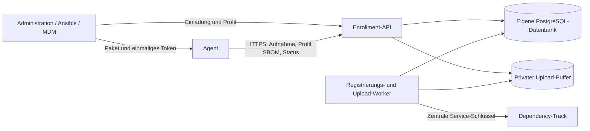

# Konzept: Enrollment- und Upload-Dienst

Stand: 14. November 2026. Architekturvorschlag, noch nicht implementiert.
Ergänzt das [Konzept zur Agent-Verteilung](agent-distribution.md).

Der [technische Detailentwurf](enrollment-architecture.md) konkretisiert Stack, Laufzeitrollen,
Datenmodell, Request-Verträge, Transaktionen, Worker-Sperren und Deployment. Er präzisiert
insbesondere die asynchrone Validierung und Barrieren bei unklarem Backend-Ausgang.

## Entscheidung und Umfang

Ein neuer Dienst `patchwatch-enrollment` übernimmt Geräteaufnahme, Konfigurationsausgabe,
Gerätezugangsdaten und die Weiterleitung der bereinigten SBOM an Dependency-Track (DTrack).
Jedes Gerät erhält eine eigene, einzeln sperrbare Berechtigung. DTrack-Schlüssel bleiben zentral.
Der Server bestimmt das Zielprojekt jedes Uploads aus seiner Gerätezuordnung.

Zum ersten produktiven Umfang gehören eine administrative CLI, eine versionierte HTTPS-API,
eine PostgreSQL-Datenbank, ein Hintergrundworker und ein begrenzter persistenter Upload-Puffer.
Eine Weboberfläche, SSO, Geräteattestierung, eine eigene PKI und ein Agent-Selbstupdater sind
spätere Erweiterungen. Paketverteilung und Betriebssystemrechte bleiben Aufgaben von Ansible/MDM
beziehungsweise der lokalen Administration. Zielgröße für den Pilot sind einige Hundert Geräte;
Kapazitätsgrenzen sind anschließend anhand tatsächlicher SBOM-Größen zu messen.

## Architektur und Vertrauensgrenzen

- Geräte erreichen ausschließlich ihre Geräte-API. Sie können weder andere Geräte auflisten
  noch DTrack-Abfragen oder administrative Aktionen durch den Dienst tunneln.
- Management-Endpunkte sind nur über einen getrennten internen Zugang erreichbar. Im MVP nutzt
  die CLI eine dedizierte Verwaltungsberechtigung aus der Geheimnisverwaltung; sie gilt niemals
  als Geräteberechtigung. Jede Aktion wird einem Verwaltungsprinzipal zugeordnet.
- Der Worker adressiert eine fest konfigurierte DTrack-URL. Vom Gerät gelieferte URLs,
  Projekt-UUIDs oder Weiterleitungsziele werden nicht verwendet.
- Die bestehende Notification-Bridge bleibt ein separater Dienst. Enrollment und Uploads
  bekommen eigene Ressourcen, Zugangsdaten und Limits.

Ein Enrollment-Token berechtigt zur Aufnahme, beweist aber keine Hardwareidentität. Wer es
vor dem legitimen Gerät erlangt, kann die Einladung einlösen. Deshalb wird es gerätebezogen
ausgegeben und über einen vertrauenswürdigen Kanal verteilt. Auch ein korrekt aufgenommenes
Gerät kann eine falsche oder unvollständige SBOM liefern; Enrollment ersetzt keine Attestierung.

## Geräteidentität und zentrale Profile

| Merkmal | Bedeutung und Autorität |
|---|---|
| `device_id` | Interne, serverseitig erzeugte UUID; Grundlage der Autorisierung |
| `host_id` | Bestehende stabile Asset-ID; bleibt bei Updates und bestätigten Migrationen erhalten |
| `project_uuid` | Serverseitige Zuordnung zu genau einem DTrack-Projekt, Version `current` |
| Hostname, OS, Distribution, Architektur | Validierte Angaben des Geräts; keine Authentisierungsmerkmale |
| Team, Umgebung, Gerätegruppe | Durch Einladung beziehungsweise Administration festgelegt |
| `profile_id` und `profile_version` | Freigegebene, versionierte Scan-Konfiguration |

Die Einladung kann eine erwartete Asset-ID und einen erwarteten Hostnamen enthalten. Abweichungen
führen zu einem Konflikt, nicht zur Übernahme eines bestehenden Geräts. Neue Asset-IDs werden
einmalig erzeugt; `UNIQUE(host_id)` und `UNIQUE(project_uuid)` verhindern doppelte Zuordnungen.
Ein Hostname ist ein Anzeigename. Eine Kollision mit einem anderen Projekt wird entsprechend
der bisherigen Registrierungslogik abgewiesen und administrativ aufgelöst.

Profile enthalten erlaubte Scan-Wurzeln, Ausschlüsse, Erweiterungserfassung, Service-Erfassung,
Timeout und Zeitplanung. Sie enthalten keine Shell-Befehle, frei wählbaren ausführbaren
Dateien oder DTrack-Zugangsdaten. Der lokale Agent validiert Schema, Pfade und Grenzen erneut;
ein Profil kann die bei Installation freigegebenen Zugriffsbereiche nicht stillschweigend
erweitern. Die lokal installierten Syft- und Programmpfade bleiben unter lokaler Kontrolle.

Serverseitige Tags entstehen aus Geräte-Metadaten und zentralen Zuordnungen. OS-/Distro-Angaben
bleiben als Selbstauskunft gekennzeichnet. Hostname- und Metadatenänderungen werden authentisiert
gemeldet und vom Registrierungsworker übernommen; Team-Änderungen benötigen Administration.
`project_uuid` bleibt dabei gleich. Profile werden vor einem Scan abgerufen und atomar gespeichert;
bei Ausfall gilt das letzte gültige Profil. Es gibt keine Fernbefehlsausführung.

## Aufnahmeablauf und Wiederholbarkeit

1. Die Administration erstellt eine Einladung für genau ein neues Gerät oder eine ausdrücklich
   freigegebene Wiederaufnahme. Profil und organisatorische Tags sind bereits festgelegt.
   Startwert für die Gültigkeit: 30 Minuten, konfigurierbar. Das Token wird einmal angezeigt,
   serverseitig nur als Digest gespeichert und nie Bestandteil des Installationspakets.
2. Ansible/MDM überträgt das Token als geschützte Datei. Ein vorgeschlagener neuer Befehl
   `patchwatch-agent enroll --token-file <pfad>` liest es ein. Weder Prozessargumente noch
   URLs enthalten das Token selbst. Der Dienstendpunkt und seine vertrauenswürdige CA werden
   unabhängig vom Token über die Installation konfiguriert.
3. Der Agent erzeugt lokal eine zufällige `enrollment_request_id` und eine zufällige
   Geräteberechtigung mit 256 Bit Entropie. Er speichert beide vor der ersten Anfrage
   atomar mit Modus `0600`. Diese Daten gehören nicht in ein geklontes Basisimage.
4. `POST /v1/enrollments` übermittelt Geräte-Metadaten, Request-ID und die neue
   Geräteberechtigung im HTTPS-Body. Das Einladungstoken steht im Authorization-Header.
   Request-Bodies und Authentisierungsheader werden an keinem Proxy oder Dienst geloggt.
5. Eine Datenbanktransaktion sperrt und prüft die Einladung, reserviert die Identität,
   speichert ausschließlich den Digest der Geräteberechtigung, verbraucht die Einladung
   und legt einen Registrierungsauftrag an. Die Antwort lautet `202 provisioning`.
   DTrack wird erst nach dieser Transaktion angesprochen.
6. Der Worker registriert das Gerät, persistiert `project_uuid` und schaltet den Zustand auf
   `active`. Der Agent fragt `GET /v1/device` mit seiner Geräteberechtigung ab und erhält
   Zustand, Profil und die eigene Gerätekennung. Während `provisioning` ist ausschließlich
   das Lesen des eigenen Aufnahmezustands erlaubt.
7. Der erste Scan lädt die bereinigte SBOM hoch. Erst nach bestätigtem Import wird
   `last_imported_at` gesetzt und die Einrichtung als betriebsbereit angezeigt.
   `active` allein bedeutet lediglich „Registrierung abgeschlossen“.

**Verlorene Antwort:** Die Geräteberechtigung ist dem Agenten schon vor dem ersten Request
bekannt. Er fragt damit seinen Zustand ab. Ist die erste Transaktion nicht erfolgt,
wiederholt er dieselbe Aufnahme mit derselben Request-ID und Berechtigung, solange die
Einladung gültig ist. Ist sie erfolgt, erhält er seinen vorhandenen Zustand. Die Wiederholung
derselben Anfrage darf keine zweite Aufnahme erzeugen; andere Nutzungen des verbrauchten
Tokens werden abgewiesen. Ein unbekanntes Gerät erhält beim Statusabruf keine Informationen
über andere Einladungen oder Geräte. Abgelaufene ungenutzte Einladungen brauchen Ersatz.
Wiederholungen liefern nur den bestehenden Zustand; sie aktivieren weder gesperrte Geräte
noch abgelaufene Credentials erneut.

**DTrack-Teilfehler:** Pro Gerät gibt es nur einen Registrierungsauftrag in Bearbeitung.
Ein persistierter Auftrag mit Lease wird nach Worker-Absturz wieder aufgenommen. Vor erneutem
Anlegen prüft der Worker das Zielprojekt anhand erwarteten Namens, Version und exakter
Asset-ID-Zuordnung. Ein nach einem Timeout bereits angelegtes passendes Projekt wird übernommen;
ein fremdes oder mehrdeutiges Projekt führt zu `registration_conflict` und benötigt Klärung.
Da PostgreSQL und DTrack keine gemeinsame Transaktion besitzen, ist dies eine Reconciliation,
keine behauptete atomare Transaktion über beide Systeme.

## Zugangsdaten, Rotation und Sperrung

Für den MVP werden zufällige, opake Bearer-Berechtigungen über HTTPS verwendet. Ihr Format
enthält eine öffentliche Credential-ID für den Datenbank-Lookup und ein 256-Bit-Geheimnis.
Gespeichert wird dessen SHA-256-Digest; die Prüfung erfolgt zeitkonstant. Das gilt für zufällige
Geheimnisse mit hoher Entropie, nicht als Passwortspeicherverfahren. Keine selbst entworfenen
Signaturprotokolle und keine zustandslosen JWTs: Der Dienst prüft Gerätestatus und Gültigkeit
bei jeder Anfrage, sodass eine Sperrung beim nächsten Autorisierungscheck greift.

Vorgeschlagene Startwerte: 90 Tage Gültigkeit, Rotation ab Tag 60, maximal 24 Stunden
Überlappung. Bei Rotation erzeugt und persistiert der Agent die neue Berechtigung zuerst
lokal und registriert sie mit der noch gültigen alten Berechtigung. Er bestätigt die neue
Berechtigung durch einen erfolgreichen Statusabruf und entfernt erst dann die alte lokale
Kopie. Wiederholte Rotationsanfragen sind über ihre Request-ID idempotent. Ein Gerät hat
höchstens zwei gleichzeitig gültige Credentials. Abgelaufene oder gesperrte Credentials
dürfen keine neuen erzeugen; lange offline gewesene Geräte benötigen eine Wiederaufnahme.

Eine Gerätesperrung widerruft sämtliche zugehörigen Credentials und stoppt wartende Uploads.
Der Worker prüft den Status unmittelbar vor einer Weiterleitung erneut. Bereits an DTrack
übertragene Daten können dadurch nicht zurückgerufen werden. Eine kompromittierte
Geräteberechtigung wird gesperrt und durch eine administrative Wiederaufnahme ersetzt.
Eine Wiederaufnahme erhält nach ausdrücklicher Freigabe Asset-ID und DTrack-Projekt, widerruft
alte Credentials und erzeugt eine neue Zugangsgeneration. Eine bloß mitgesendete `host_id`
oder ein bekannter Hostname genügt dafür nicht.

HTTPS, Autorisierung je Endpunkt und der Ausschluss von Geheimnissen aus URLs orientieren
sich an der [OWASP REST Security Cheat Sheet](https://cheatsheetseries.owasp.org/cheatsheets/REST_Security_Cheat_Sheet.html).
Bearer-Credentials bleiben bei Diebstahl nutzbar, bis sie gesperrt oder abgelaufen sind;
hardwaregebundene Schlüssel beziehungsweise mTLS sind eine mögliche spätere Ausbaustufe.

## Upload und Importstatus

Der Agent erzeugt weiterhin lokal die datensparsam bereinigte CycloneDX-SBOM. Er sendet
sie an `POST /v1/device/uploads` mit seiner Geräteberechtigung und einer vor dem Senden
persistierten `scan_id`. Der Server bestimmt einen Inhaltsdigest und bindet die Scan-ID
an Gerät, Inhalt und eine monotone Upload-Sequenz. Gleiche ID und gleicher Inhalt liefern
denselben Auftrag; gleiche ID mit anderem Inhalt ergibt `409 Conflict`.

Die API akzeptiert nur CycloneDX-JSON in einer unterstützten Schema-Version. Startlimit:
120 MiB für die reine JSON-Nutzlast, damit unter dem bestehenden 128-MiB-Multipartlimit
Reserve bleibt. Das tatsächliche DTrack- und Ingress-Limit ist im Integrationstest zu bestätigen.
Ingress, Parser, Puffer und Worker erhalten konsistente Größen-, Zeit- und Parallelitätsgrenzen.
Komprimierte Uploads sind im MVP ausgeschlossen. Der Dienst prüft Schema, Referenzen,
Komponentenzahl und die bestehende Datenminimierung; unbekannte beziehungsweise nicht
erlaubte Felder werden abgewiesen. Eine leere Inventur ist nur bei zentral freigegebenem
Profil erlaubt. Fremde Projektparameter und Ziel-URLs sind nicht Teil des API-Vertrags.

Vor `202 Accepted` wird die vollständige Nutzlast in einem privaten persistenten Puffer
gesichert und der Auftrag in PostgreSQL angelegt. Die vollständige Schema- und Inhaltsprüfung
erfolgt danach asynchron vor der Weiterleitung; `202` bestätigt noch keine gültige SBOM.
Ein Dateiname wird ausschließlich aus
serverseitigen IDs gebildet. Schreiben in temporäre Datei, Synchronisieren und atomare
Umbenennung erfolgen vor dem Commit des Auftrags. Verwaiste Dateien nach einem Absturz
werden bei der Bereinigung entfernt; ein Auftrag mit fehlender Datei schlägt sichtbar fehl.

Der Worker verarbeitet Uploads desselben Geräts nacheinander. Er baut die DTrack-Anfrage
selbst auf: ausschließlich serverseitiges `project_uuid`, `autoCreate=false`, keine vom
Agenten übernommenen Projekt-Tags oder Zielparameter. Der DTrack-Verarbeitungstoken bleibt
intern; der Agent sieht nur die eigene Upload-ID und einen begrenzten Status.
Der UUID-basierte Upload ist durch die [DTrack-Integrationsdokumentation](https://docs.dependencytrack.org/usage/cicd/)
beschrieben; die konkrete Statusauswertung wird gegen die eingesetzte Version 5.2.1 getestet.

| Uploadzustand | Bedeutung |
|---|---|
| `queued` | Dauerhaft angenommen, noch nicht an DTrack gesendet |
| `sending` | Weiterleitung läuft |
| `processing` | DTrack hat einen Verarbeitungstoken geliefert |
| `imported` | DTrack meldet die Verarbeitung als abgeschlossen; CVE-Matching kann nachlaufen |
| `failed` | Definitiver Fehler, mit unkritischem Fehlercode und Wiederholbarkeitshinweis |
| `delivery_unknown` | DTrack könnte angenommen haben, aber die Antwort beziehungsweise der Token fehlt |
| `cancelled` | Vor Weiterleitung administrativ oder durch Gerätesperrung gestoppt |

Nach einem Verbindungsabbruch während der DTrack-Weiterleitung kann keine exakt einmalige
Verarbeitung zugesichert werden. `delivery_unknown` blockiert zunächst weitere Uploads
dieses Geräts, damit ein verspäteter alter Import keinen neueren überschreibt. Im MVP klärt
die Administration den Zustand anhand DTrack und gibt eine Wiederholung oder Fortsetzung frei.
Eine Wiederholung desselben Inhalts kann einen erneuten Import auslösen und wird auditiert.
Bei unbekanntem Abschluss nach Verarbeitungstoken wird weiter gepollt beziehungsweise ein
Alarm ausgelöst; ein Timeout wird nicht als bestätigter Import ausgegeben.

Ein Agent startet keinen zweiten Scan-Upload, solange sein vorheriger Auftrag offen ist.
Quoten begrenzen offene Aufträge und Pufferplatz pro Gerät sowie global. Bei ausgeschöpfter
Kapazität antwortet die API mit `429` oder `503` und `Retry-After`, vor einer Annahme.
Upload-Slots und maximaler Pufferbedarf werden bereits vor dem Lesen des Request-Bodys
reserviert; abgebrochene Übertragungen geben die Reservierung und temporäre Dateien frei.
Ein begrenzt aufbewahrter lokaler, bereinigter Upload ermöglicht Wiederholungen ohne neuen
Vollscan. Er bleibt privat und wird nach Bestätigung oder einer dokumentierten Frist gelöscht.

## API-Skizze

Alle Pfade sind Vorschläge; vor Implementierung werden sie als OpenAPI-Vertrag festgeschrieben.

| Endpunkt | Berechtigung | Aufgabe |
|---|---|---|
| `POST /v1/admin/invitations` | Verwaltung | Einmalige Einladung erzeugen; auch freigegebene Wiederaufnahme |
| `DELETE /v1/admin/invitations/{id}` | Verwaltung | Ungenutzte Einladung widerrufen |
| `GET /v1/admin/devices` | Verwaltung | Geräte, Aufnahmefehler und Importalter anzeigen |
| `POST /v1/admin/devices/{id}/revoke` | Verwaltung | Gerät sperren und wartende Aufträge stoppen |
| `PUT /v1/admin/devices/{id}/profile` | Verwaltung | Versioniertes Profil zuweisen |
| `POST /v1/admin/uploads/{id}/resolve` | Verwaltung | Unklaren Versand mit Begründung auflösen |
| `POST /v1/enrollments` | Einladung | Aufnahme starten beziehungsweise identisch wiederholen |
| `GET /v1/device` | Gerät | Eigener Zustand, Metadaten, Profilversion und Importzeit |
| `PATCH /v1/device/metadata` | Aktives Gerät | Eigene technische Metadatenänderung melden |
| `GET /v1/device/config` | Aktives Gerät | Eigene Konfiguration mit ETag/Version abrufen |
| `POST /v1/device/credentials` | Aktives Gerät | Neue Berechtigung für Rotation registrieren |
| `POST /v1/device/credentials/{id}/confirm` | Neues Geräte-Credential | Besitz bestätigen und Rotationsüberlappung beginnen |
| `DELETE /v1/device/credentials/{id}` | Aktives Gerät | Eigene alte Berechtigung widerrufen |
| `POST /v1/device/uploads` | Aktives Gerät | SBOM für das eigene Projekt einstellen |
| `GET /v1/device/uploads/{id}` | Aktives Gerät | Ausschließlich eigenen Importstatus lesen |

Gerätepfade enthalten keine frei auswählbare `device_id`. Auch Upload- und Credential-IDs
werden immer zusammen mit dem authentisierten Gerät geprüft. Profile werden nur in der
dem Gerät zugewiesenen Version ausgeliefert. Fehlerantworten enthalten feste Codes wie
`INVITATION_EXPIRED`, `IDENTITY_CONFLICT`, `DEVICE_REVOKED`, `PROFILE_INVALID` oder
`UPLOAD_TOO_LARGE` und eine Korrelations-ID, keine DTrack-Response-Bodies oder Geheimnisse.
Aufnahme und Rotation bekommen `Cache-Control: no-store`. Alle Endpunkte besitzen
explizite Request-Schemas; unbekannte Felder werden zurückgewiesen.

## Speicherung, Rechte und Betrieb

Persistiert werden `devices`, `credentials`, `invitations`, `profiles`, `registration_jobs`,
`upload_jobs` und `audit_events`. Dazu gehören Zustände, Gültigkeit, Zuordnungen, Request-IDs,
Profilversionen, Leases und letzte Kontakt-/Importzeiten. Constraints sichern eindeutige
Identitäten und Request-IDs; Transaktionen sichern Einladungsverbrauch und Auftragsannahme.
Eine eigene Datenbank mit eigenem Benutzer trennt den Dienst von DTrack; keine Zugriffe auf
DTrack-interne Tabellen. Bestehende PostgreSQL-Infrastruktur kann dafür genutzt werden.

DTrack erhält zwei dedizierte Service-Prinzipale: Registrierung für Projekt-/Tag-Verwaltung
und Upload für BOM-Upload. Geplant sind `VIEW_PORTFOLIO`, `PORTFOLIO_MANAGEMENT` und gegebenenfalls
`TAG_MANAGEMENT` für Registrierung sowie `BOM_UPLOAD` für Upload. Die exakten Rechte für jeden
genutzten Endpunkt, ACLs und Token-Polling werden gegen die OpenAPI der installierten Version
mit Positiv- und Negativtests bestätigt. `PROJECT_CREATION_UPLOAD`, `ACCESS_MANAGEMENT` und
`SYSTEM_CONFIGURATION` werden nicht vorsorglich vergeben. Die [DTrack-Rechteübersicht](https://docs.dependencytrack.org/administration/users-and-permissions/)
beschreibt die grundsätzlichen Rollen; sie ersetzt diesen Endpunkt-Test nicht.

Für den Pilot genügen eine Service-Instanz mit API und Worker, PostgreSQL und ein privates PVC.
Die Anwendung läuft ohne root und mit begrenzten Ressourcen; Workerverarbeitung ist über Leases
abgesichert. Mehrere Replikate setzen einen gemeinsam nutzbaren Puffer beziehungsweise
Objektspeicher und getestete Lease-/Failover-Logik voraus. Der lokale Puffer darf dabei
nicht versehentlich pro Replikat getrennt sein.

Helm und Compose erhalten einen eigenen Service, Secrets, Speicher und Healthchecks.
Netzwerkregeln erlauben externe Gerätezugriffe nur zur Geräte-API, Managementzugriffe nur
aus der Verwaltung und Backend-Zugriffe nur auf PostgreSQL und DTrack. Der öffentliche
DTrack-Zugang für Administratoren bleibt eine gesonderte Entscheidung. Enrollment nutzt
einen eigenen Hostnamen beziehungsweise klar getrennte Ingress-Routen; Backend-Zugriffe
werden nach dem vorhandenen Vertrauensmodell abgesichert. Geräte-TLS wird immer geprüft.

Audit protokolliert Einladungserstellung/-verbrauch, Profiländerung, Registrierung, Rotation,
Sperrung und manuelle Fehlerauflösung mit Zeit, Akteur und Ziel-ID. Keine Tokens, vollständigen
SBOMs, Benutzerpfade oder unbereinigten Backend-Fehler in Logs. Vorgeschlagene Fristen:
abgeschlossene Upload-Nutzlasten sofort löschen, andere nach spätestens 24 Stunden und dann
noch nicht versandte Aufträge sichtbar fehlschlagen lassen. Bei unklarem Versand oder offener
DTrack-Verarbeitung bleibt die Versandsperre auch ohne Payload erhalten; Bereinigung darf
keinen neuen Versand freigeben. Status-/Idempotenzdaten terminaler Aufträge 90 Tage, Audit 180 Tage.
Gesperrte Geräte bleiben bis zur administrativen Löschung als Identitätsreservierung bestehen.
Diese Fristen sind Betriebsparameter und vor Produktivbetrieb abzustimmen.

Metriken erfassen Aufnahmefehler, aktive/gesperrte Geräte, Queue-Alter, Pufferbelegung,
abgelaufene Leases, `delivery_unknown`, Profilfehler und Alter des letzten bestätigten Imports.
Ein Heartbeat ersetzt keinen Importnachweis. Ausfall des Enrollment-Dienstes verzögert Uploads;
er beeinflusst die bestehenden DTrack-Auswertungen nicht. Ein DTrack-Ausfall wird nur bis zu
den festgelegten Quoten gepuffert und darf Speicher nicht unbegrenzt belegen.

Datenbank und Secrets werden gesichert; die kurzlebige Upload-Nutzlast wird im MVP nicht
gesichert. Beim Restore werden fehlende Nutzlasten als verloren markiert und erneut angefordert.
Ein Restore kann veraltete Sperrungen, verbrauchte Einladungen und Auftragszustände zurückbringen.
Deshalb zunächst Gerätezugang sperren, alle restaurierten Einladungen ungültig machen,
Geräteberechtigungen im MVP vollständig widerrufen und eine kontrollierte Wiederaufnahme
durchführen. Projekte und Asset-IDs bleiben erhalten. Unklare Backend-Aufträge werden vor
Wiederaufnahme des Workers abgeglichen. Ein Restore-Test ist Teil der Abnahme.

## Anpassungen im Repository und Migration

| Bereich | Erforderliche Änderung |
|---|---|
| `patchwatch/agent/` (`runner.py`, `cli.py`) | Transportmodus `enrollment`, Aufnahme, Profilabruf, Rotation und lokaler Status |
| `patchwatch/core/sbom.py` | Scanner/Bereinigung beibehalten; Uploadtransport vom direkten DTrack-Client trennen |
| `patchwatch/core/tags.py` | Explizite Zielgeräte-Metadaten für zentrale Registrierung unterstützen |
| `patchwatch/dtrack/register.py` | Wiederverwendbare Registrierung mit Reconciliation statt lokal erkannter Server-Metadaten |
| Neuer Enrollment-Service | API, Datenmodell, Migrationen, Autorisierung, Puffer und Worker |
| `patchwatch/dtrack/setup.py` | Dedizierte DTrack-Service-Teams mit geprüften Minimalrechten |
| Helm, Compose, CI | Deployment, Secrets, Backup, Netzwerkregeln, Image und Integrationstests |
| Agent-Pakete und Dokumentation | Enrollment-CLI, sichere Tokenübergabe, Diagnose und Betriebsabläufe |

Bestandsgeräte werden in Wellen migriert: Administration importiert die geprüfte Zuordnung
aus `host_id` und `project_uuid` und erstellt dafür eine Wiederaufnahme-Einladung. Ein
unregistriertes Altgerät wird erst eindeutig einem Projekt zugeordnet. Der Agent stoppt
zunächst direkte geplante Uploads, führt die Aufnahme durch und bestätigt einen Import über
den neuen Transport. Danach entfernt die Verwaltung den alten lokalen DTrack-Schlüssel
und aktiviert den neuen Zeitplan. Bei Fehlern bleibt der Migrationszustand sichtbar;
ein Rückweg vor Schlüsselwiderruf wird ausdrücklich durch die Verwaltung ausgelöst.

Während der Migration bleiben direkte und neue Geräte technisch nebeneinander betreibbar.
Der alte gemeinsame Agent-Schlüssel wird erst nach vollständiger Umstellung widerrufen;
bis dahin ist die neue Isolation gegenüber Besitzern dieses alten Schlüssels nicht vollständig.
CI behält seinen bereits getrennten CI-Upload-Key. Ein fehlgeschlagener Enrollment-Upload
führt niemals automatisch zum Rückfall auf einen alten gemeinsamen Schlüssel.

## Lieferstufen und Abnahme

1. **Vertrag und Durchstich:** OpenAPI, Zustandsmodell und Bedrohungsannahmen festlegen.
   DTrack-Minimalrechte, Profilvalidierung und Crash-Reconciliation in einer Testinstanz
   prüfen. Ergebnis: ein Gerät wird registriert und ein bestehendes Projekt bleibt erhalten.
2. **Produktiver Mindestumfang:** Einladungen, Geräteberechtigungen, Rotation, Sperrung,
   Profile, persistenter Puffer, Importstatus und administrative CLI implementieren.
   Agenttransport und Migration ergänzen; Helm-/Compose-Betrieb und Restore testen.
3. **Pilot und Ausbau:** Kleine Linux-/macOS-Gruppe aufnehmen, Fehlerfälle erproben,
   Quoten und Aufbewahrung messen. Danach breiter Rollout; Weboberfläche, SSO, mTLS und
   mehrere Replikate nur nach eigenem Bedarf und Entwurf ergänzen.

Vor Produktivfreigabe müssen folgende Szenarien nachgewiesen sein:

- Zwei gleichzeitige Einlösungen einer Einladung erzeugen höchstens ein Gerät; dieselbe
  Aufnahme bleibt nach verlorener Antwort wiederholbar.
- Eine kopierte `host_id`, fremde Upload-ID oder fremde Credential-ID gewährt keinen Zugriff.
- Ein Gerät kann weder Zielprojekt noch Team-Tags ändern oder ein DTrack-Projekt automatisch anlegen.
- Ein Worker-Absturz nach DTrack-Projektanlage erzeugt beim Neustart kein zweites Projekt.
- Derselbe Scan wird als derselbe Auftrag erkannt; geänderter Inhalt mit gleicher ID wird abgewiesen.
- Ein verlorener DTrack-Response wird als unklar behandelt; neuere Uploads überholen ihn nicht.
- Sperrung, Rotation mit verlorener Antwort und abgelaufene Berechtigungen verhalten sich wie beschrieben.
- Übergröße, langsame Uploads, voller Puffer und ungültige SBOMs belegen keine unbegrenzten Ressourcen.
- Profiländerung, Serverausfall, Bestandsmigration und Restore erhalten Asset-ID und Projektzuordnung.
- Quellcode-, Log- und Artefaktprüfung findet keine Gerätegeheimnisse oder DTrack-Schlüssel
  in Installationspaketen, CLI-Argumenten oder regulären Logs.

Die vorgeschlagenen API-Pfade, Fristen und Limits sind konkrete Entwurfsentscheidungen für
die Umsetzung; sie behaupten keine bereits vorhandenen Fähigkeiten des Agenten oder DTrack.
