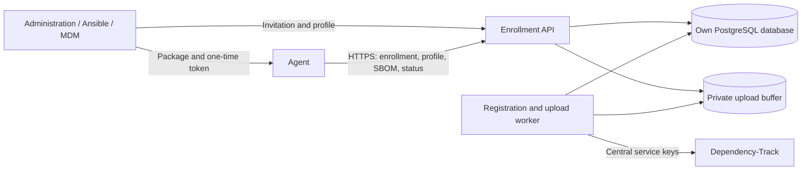

# Concept: enrollment and upload service

As of: 14 November 2026. Architecture proposal, not yet implemented.
Supplements the [agent distribution concept](agent-distribution.md).

The [detailed technical design](enrollment-architecture.md) specifies the stack, runtime roles,
data model, request contracts, transactions, worker locks and deployment. In particular, it refines
the asynchronous validation and barriers for an unclear backend outcome.

## Decision and scope

A new service `patchwatch-enrollment` takes over device onboarding, configuration output,
device credentials and the forwarding of the sanitized SBOM to Dependency-Track (DTrack).
Every device receives its own individually revocable permission. DTrack keys stay central.
The server determines the target project of every upload from its device assignment.

The first productive scope includes an administrative CLI, a versioned HTTPS API,
a PostgreSQL database, a background worker and a bounded persistent upload buffer.
A web interface, SSO, device attestation, a PKI of its own and an agent self-updater are
later extensions. Package distribution and operating system permissions remain tasks of Ansible/MDM
or local administration respectively. The target size for the pilot is a few hundred devices;
capacity limits are then to be measured based on actual SBOM sizes.

## Architecture and trust boundaries

- Devices reach only their device API. They can neither list other devices
  nor tunnel DTrack queries or administrative actions through the service.
- Management endpoints are reachable only via a separate internal access. In the MVP, the
  CLI uses a dedicated management permission from the secret management; it never counts
  as a device permission. Every action is assigned to a management principal.
- The worker addresses a fixed configured DTrack URL. URLs, project UUIDs or
  forwarding targets supplied by the device are not used.
- The existing notification bridge remains a separate service. Enrollment and uploads
  get their own resources, credentials and limits.

An enrollment token authorizes onboarding but proves no hardware identity. Whoever obtains it
before the legitimate device can redeem the invitation. It is therefore issued per device
and distributed over a trusted channel. Even a correctly onboarded
device can deliver a wrong or incomplete SBOM; enrollment replaces no attestation.

## Device identity and central profiles

| Attribute | Meaning and authority |
|---|---|
| `device_id` | Internal, server-generated UUID; basis of authorization |
| `host_id` | Existing stable asset ID; is kept across updates and confirmed migrations |
| `project_uuid` | Server-side assignment to exactly one DTrack project, version `current` |
| Hostname, OS, distribution, architecture | Validated statements of the device; no authentication attributes |
| Team, environment, device group | Defined by invitation or administration |
| `profile_id` and `profile_version` | Approved, versioned scan configuration |

The invitation can contain an expected asset ID and an expected hostname. Deviations
lead to a conflict, not to the takeover of an existing device. New asset IDs are generated
once; `UNIQUE(host_id)` and `UNIQUE(project_uuid)` prevent duplicate assignments.
A hostname is a display name. A collision with a different project is rejected according to
the previous registration logic and resolved administratively.

Profiles contain permitted scan roots, exclusions, extension collection, service collection,
timeout and scheduling. They contain no shell commands, freely selectable executable
files or DTrack credentials. The local agent validates schema, paths and limits again;
a profile cannot silently extend the access areas released at installation.
The locally installed Syft and program paths remain under local control.

Server-side tags are derived from device metadata and central assignments. OS/distro statements
stay marked as self-reported. Hostname and metadata changes are reported in authenticated form
and adopted by the registration worker; team changes need administration.
`project_uuid` stays the same. Profiles are fetched before a scan and stored atomically;
on failure, the last valid profile applies. There is no remote command execution.

## Onboarding flow and repeatability

1. The administration creates an invitation for exactly one new device or an explicitly
   approved re-onboarding. Profile and organizational tags are already set.
   Starting value for the validity: 30 minutes, configurable. The token is shown once,
   stored on the server only as a digest and never part of the installation package.
2. Ansible/MDM transfers the token as a protected file. A proposed new command
   `patchwatch-agent enroll --token-file <path>` reads it. Neither process arguments nor
   URLs contain the token itself. The service endpoint and its trusted CA are configured
   independently of the token through the installation.
3. The agent locally generates a random `enrollment_request_id` and a random
   device credential with 256 bits of entropy. It stores both atomically with mode `0600`
   before the first request. This data does not belong in a cloned base image.
4. `POST /v1/enrollments` transmits device metadata, request ID and the new
   device credential in the HTTPS body. The invitation token is in the Authorization header.
   Request bodies and authentication headers are logged at no proxy or service.
5. A database transaction locks and checks the invitation, reserves the identity,
   stores only the digest of the device credential, consumes the invitation
   and creates a registration job. The response is `202 provisioning`.
   DTrack is contacted only after this transaction.
6. The worker registers the device, persists `project_uuid` and switches the state to
   `active`. The agent queries `GET /v1/device` with its device credential and receives
   state, profile and its own device identifier. While `provisioning`, only
   reading its own onboarding state is allowed.
7. The first scan uploads the sanitized SBOM. Only after a confirmed import is
   `last_imported_at` set and the setup shown as operational.
   `active` alone merely means "registration completed".

**Lost response:** The device credential is known to the agent even before the first request.
It uses it to query its state. If the first transaction did not take place,
it repeats the same onboarding with the same request ID and credential as long as the
invitation is valid. If it did, it receives its existing state. Repeating
the same request must not create a second onboarding; other uses of the consumed
token are rejected. An unknown device receives no information about other invitations
or devices on a status query. Expired unused invitations need a replacement.
Repetitions deliver only the existing state; they reactivate neither revoked devices
nor expired credentials.

**DTrack partial failure:** There is only one registration job in progress per device.
A persisted job with a lease is resumed after a worker crash. Before creating again,
the worker checks the target project by expected name, version and exact
asset ID assignment. A matching project already created after a timeout is adopted;
a foreign or ambiguous project leads to `registration_conflict` and needs clarification.
Since PostgreSQL and DTrack share no transaction, this is a reconciliation,
not a claimed atomic transaction across both systems.

## Credentials, rotation and revocation

For the MVP, random, opaque bearer credentials over HTTPS are used. Their format
contains a public credential ID for the database lookup and a 256-bit secret.
Its SHA-256 digest is stored; verification is constant-time. This applies to random
secrets with high entropy, not as a password storage method. No self-designed
signature protocols and no stateless JWTs: the service checks device status and validity
on every request so that a revocation takes effect at the next authorization check.

Proposed starting values: 90 days validity, rotation from day 60, at most 24 hours
overlap. On rotation, the agent first creates and persists the new credential
locally and registers it with the still-valid old credential. It confirms the new
credential through a successful status query and only then removes the old local
copy. Repeated rotation requests are idempotent via their request ID. A device has
at most two simultaneously valid credentials. Expired or revoked credentials
may not create new ones; devices that were offline for a long time need re-onboarding.

A device revocation revokes all associated credentials and stops waiting uploads.
The worker checks the status again immediately before forwarding. Data already
transferred to DTrack cannot be recalled this way. A compromised
device credential is revoked and replaced by an administrative re-onboarding.
After explicit approval, a re-onboarding keeps asset ID and DTrack project, revokes
old credentials and creates a new credential generation. A merely sent `host_id`
or a known hostname does not suffice for this.

HTTPS, authorization per endpoint and the exclusion of secrets from URLs follow
the [OWASP REST Security Cheat Sheet](https://cheatsheetseries.owasp.org/cheatsheets/REST_Security_Cheat_Sheet.html).
Bearer credentials remain usable when stolen until they are revoked or expired;
hardware-bound keys or mTLS are a possible later extension stage.

## Upload and import status

The agent continues to create the data-minimized sanitized CycloneDX SBOM locally. It sends
it to `POST /v1/device/uploads` with its device credential and a `scan_id` persisted
before sending. The server determines a content digest and binds the scan ID
to device, content and a monotonic upload sequence. The same ID and same content yield
the same job; the same ID with different content results in `409 Conflict`.

The API accepts only CycloneDX JSON in a supported schema version. Starting limit:
120 MiB for the pure JSON payload so that reserve remains under the existing 128 MiB multipart limit.
The actual DTrack and ingress limit is to be confirmed in the integration test.
Ingress, parser, buffer and worker receive consistent size, time and concurrency limits.
Compressed uploads are excluded in the MVP. The service checks schema, references,
component count and the existing data minimization; unknown or not
permitted fields are rejected. An empty inventory is allowed only with a
centrally approved profile. Foreign project parameters and target URLs are not part of the API contract.

Before `202 Accepted`, the complete payload is secured in a private persistent buffer
and the job is created in PostgreSQL. The complete schema and content check
takes place afterwards, asynchronously, before forwarding; `202` does not yet confirm a valid SBOM.
A file name is formed exclusively from
server-side IDs. Writing to a temporary file, syncing and atomic
renaming take place before the commit of the job. Orphaned files after a crash
are removed during cleanup; a job with a missing file fails visibly.

The worker processes uploads of the same device one after another. It builds the DTrack request
itself: exclusively the server-side `project_uuid`, `autoCreate=false`, no project tags or
target parameters taken over from the agent. The DTrack processing token stays
internal; the agent sees only its own upload ID and a limited status.
The UUID-based upload is described by the [DTrack integration documentation](https://docs.dependencytrack.org/usage/cicd/);
the concrete status evaluation is tested against the version 5.2.1 in use.

| Upload state | Meaning |
|---|---|
| `queued` | Durably accepted, not yet sent to DTrack |
| `sending` | Forwarding in progress |
| `processing` | DTrack has delivered a processing token |
| `imported` | DTrack reports processing as completed; CVE matching can lag behind |
| `failed` | Definitive error, with a non-critical error code and a retryability note |
| `delivery_unknown` | DTrack might have accepted, but the response or the token is missing |
| `cancelled` | Stopped before forwarding administratively or by device revocation |

After a connection abort during DTrack forwarding, no exactly-once
processing can be guaranteed. `delivery_unknown` first blocks further uploads
of this device so that a late old import does not overwrite a newer one. In the MVP, the
administration clarifies the state based on DTrack and approves a retry or continuation.
Repeating the same content can trigger a renewed import and is audited.
With an unknown completion after the processing token, polling continues or an
alarm is raised; a timeout is not reported as a confirmed import.

An agent starts no second scan upload while its previous job is open.
Quotas limit open jobs and buffer space per device and globally. When capacity is
exhausted, the API responds with `429` or `503` and `Retry-After`, before acceptance.
Upload slots and maximum buffer demand are reserved before reading the request body;
aborted transfers release the reservation and temporary files.
A locally retained, sanitized upload kept for a limited time enables retries without a new
full scan. It stays private and is deleted after confirmation or a documented period.

## API sketch

All paths are proposals; before implementation they are fixed as an OpenAPI contract.

| Endpoint | Permission | Task |
|---|---|---|
| `POST /v1/admin/invitations` | Management | Create a one-time invitation; also approved re-onboarding |
| `DELETE /v1/admin/invitations/{id}` | Management | Revoke an unused invitation |
| `GET /v1/admin/devices` | Management | Show devices, onboarding errors and import age |
| `POST /v1/admin/devices/{id}/revoke` | Management | Revoke a device and stop waiting jobs |
| `PUT /v1/admin/devices/{id}/profile` | Management | Assign a versioned profile |
| `POST /v1/admin/uploads/{id}/resolve` | Management | Resolve an unclear delivery with justification |
| `POST /v1/enrollments` | Invitation | Start onboarding or repeat it identically |
| `GET /v1/device` | Device | Own state, metadata, profile version and import time |
| `PATCH /v1/device/metadata` | Active device | Report own technical metadata change |
| `GET /v1/device/config` | Active device | Fetch own configuration with ETag/version |
| `POST /v1/device/credentials` | Active device | Register a new credential for rotation |
| `POST /v1/device/credentials/{id}/confirm` | New device credential | Confirm possession and begin rotation overlap |
| `DELETE /v1/device/credentials/{id}` | Active device | Revoke own old credential |
| `POST /v1/device/uploads` | Active device | Submit an SBOM for the own project |
| `GET /v1/device/uploads/{id}` | Active device | Read exclusively the own import status |

Device paths contain no freely selectable `device_id`. Upload and credential IDs
are likewise always checked together with the authenticated device. Profiles are delivered only in the
version assigned to the device. Error responses contain fixed codes such as
`INVITATION_EXPIRED`, `IDENTITY_CONFLICT`, `DEVICE_REVOKED`, `PROFILE_INVALID` or
`UPLOAD_TOO_LARGE` and a correlation ID, no DTrack response bodies or secrets.
Onboarding and rotation get `Cache-Control: no-store`. All endpoints have
explicit request schemas; unknown fields are rejected.

## Storage, permissions and operation

Persisted are `devices`, `credentials`, `invitations`, `profiles`, `registration_jobs`,
`upload_jobs` and `audit_events`. These include states, validity, assignments, request IDs,
profile versions, leases and last contact/import times. Constraints ensure unique
identities and request IDs; transactions ensure invitation consumption and job acceptance.
A database of its own with a user of its own separates the service from DTrack; no access to
DTrack-internal tables. Existing PostgreSQL infrastructure can be used for this.

DTrack receives two dedicated service principals: registration for project/tag management
and upload for BOM upload. Planned are `VIEW_PORTFOLIO`, `PORTFOLIO_MANAGEMENT` and, if applicable,
`TAG_MANAGEMENT` for registration and `BOM_UPLOAD` for upload. The exact permissions for every
endpoint used, ACLs and token polling are confirmed against the OpenAPI of the installed version
with positive and negative tests. `PROJECT_CREATION_UPLOAD`, `ACCESS_MANAGEMENT` and
`SYSTEM_CONFIGURATION` are not granted as a precaution. The [DTrack permissions overview](https://docs.dependencytrack.org/administration/users-and-permissions/)
describes the basic roles; it does not replace this endpoint test.

For the pilot, one service instance with API and worker, PostgreSQL and a private PVC suffice.
The application runs without root and with limited resources; worker processing is secured via leases.
Multiple replicas require a shareable buffer or
object storage and tested lease/failover logic. The local buffer must
not accidentally be separate per replica.

Helm and Compose get a service of their own, secrets, storage and health checks.
Network rules allow external device access only to the device API, management access only
from the administration and backend access only to PostgreSQL and DTrack. The public
DTrack access for administrators remains a separate decision. Enrollment uses
a hostname of its own or clearly separated ingress routes; backend access is
secured according to the existing trust model. Device TLS is always verified.

Audit logs invitation creation/consumption, profile change, registration, rotation,
revocation and manual error resolution with time, actor and target ID. No tokens, complete
SBOMs, user paths or unsanitized backend errors in logs. Proposed periods:
delete completed upload payloads immediately, others after 24 hours at the latest, and then
let not-yet-sent jobs fail visibly. With an unclear delivery or open
DTrack processing, the sending lock remains even without a payload; cleanup must not
release a new delivery. Status/idempotency data of terminal jobs 90 days, audit 180 days.
Revoked devices remain as an identity reservation until administrative deletion.
These periods are operating parameters and to be agreed before productive operation.

Metrics capture onboarding errors, active/revoked devices, queue age, buffer occupancy,
expired leases, `delivery_unknown`, profile errors and age of the last confirmed import.
A heartbeat replaces no import proof. A failure of the enrollment service delays uploads;
it does not affect the existing DTrack evaluations. A DTrack outage is buffered only up to
the defined quotas and must not occupy storage without limit.

Database and secrets are backed up; the short-lived upload payload is not
backed up in the MVP. On restore, missing payloads are marked as lost and requested again.
A restore can bring back outdated revocations, consumed invitations and job states.
Therefore first block device access, invalidate all restored invitations,
fully revoke device credentials in the MVP and perform a controlled re-onboarding.
Projects and asset IDs are kept. Unclear backend jobs are reconciled before the
worker resumes. A restore test is part of the acceptance.

## Changes in the repository and migration

| Area | Required change |
|---|---|
| `patchwatch/agent/` (`runner.py`, `cli.py`) | Transport mode `enrollment`, onboarding, profile fetch, rotation and local status |
| `patchwatch/core/sbom.py` | Keep scanner/sanitizing; separate upload transport from the direct DTrack client |
| `patchwatch/core/tags.py` | Support explicit target device metadata for central registration |
| `patchwatch/dtrack/register.py` | Reusable registration with reconciliation instead of locally detected server metadata |
| New enrollment service | API, data model, migrations, authorization, buffer and worker |
| `patchwatch/dtrack/setup.py` | Dedicated DTrack service teams with verified minimal permissions |
| Helm, Compose, CI | Deployment, secrets, backup, network rules, image and integration tests |
| Agent packages and documentation | Enrollment CLI, secure token handover, diagnostics and operating flows |

Existing devices are migrated in waves: the administration imports the verified assignment
from `host_id` and `project_uuid` and creates a re-onboarding invitation for it. An
unregistered legacy device is first unambiguously assigned to a project. The agent first
stops direct scheduled uploads, performs the onboarding and confirms an import via
the new transport. Afterwards the management removes the old local DTrack key
and enables the new schedule. On errors, the migration state stays visible;
a way back before key revocation is explicitly triggered by the management.

During the migration, direct and new devices can technically be operated side by side.
The old shared agent key is revoked only after full conversion;
until then, the new isolation is not complete against holders of this old key.
CI keeps its already separate CI upload key. A failed enrollment upload
never automatically leads to a fallback to an old shared key.

## Delivery stages and acceptance

1. **Contract and spike:** Fix OpenAPI, state model and threat assumptions.
   Verify DTrack minimal permissions, profile validation and crash reconciliation in a test instance.
   Result: a device is registered and an existing project is kept.
2. **Productive minimum scope:** Implement invitations, device credentials, rotation, revocation,
   profiles, persistent buffer, import status and administrative CLI.
   Add agent transport and migration; test Helm/Compose operation and restore.
3. **Pilot and extension:** Onboard a small Linux/macOS group, trial failure cases,
   measure quotas and retention. Then broader rollout; add web interface, SSO, mTLS and
   multiple replicas only according to a need and design of their own.

Before productive release, the following scenarios must be demonstrated:

- Two simultaneous redemptions of an invitation create at most one device; the same
  onboarding stays repeatable after a lost response.
- A copied `host_id`, foreign upload ID or foreign credential ID grants no access.
- A device can neither change the target project or team tags nor automatically create a DTrack project.
- A worker crash after DTrack project creation creates no second project on restart.
- The same scan is recognized as the same job; changed content with the same ID is rejected.
- A lost DTrack response is treated as unclear; newer uploads do not overtake it.
- Revocation, rotation with a lost response and expired credentials behave as described.
- Oversize, slow uploads, full buffer and invalid SBOMs occupy no unlimited resources.
- Profile change, server outage, existing-device migration and restore preserve asset ID and project assignment.
- Source code, log and artifact review finds no device secrets or DTrack keys
  in installation packages, CLI arguments or regular logs.

The proposed API paths, periods and limits are concrete design decisions for
the implementation; they claim no already existing capabilities of the agent or DTrack.
